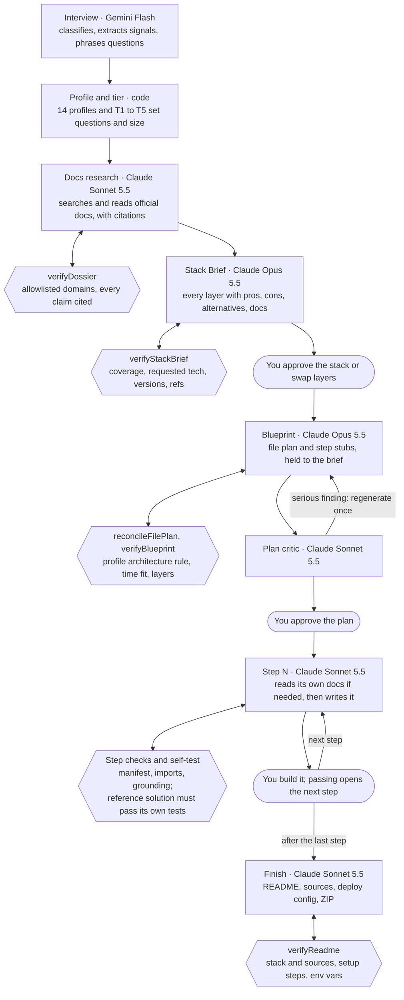

<!-- Exported from the Project Learner plan doc on 2026-10-22. Diagrams are Mermaid versions of the doc's drawings. v2.1 (2026-10-23) checks the plan against the repo at f6f7133 and re-sizes the build to 12 hours on one Claude Pro plan. Claude Code sessions read it from here (section 15). -->

# Project Learner — Engineering Plan v2.1

Oct 23, 2026 · @Ali Noor

**What changed from v2.0.** The work is split into seven implementation phases (section 15); phases 1 to 3 are a 12-hour build, one Claude Code session per Pro usage window, shipping one vertical slice behind the flag. Questions run on Gemini Flash, the tutor on Gemini 4 Argon, project generation on Claude. Creating a project is cut from about $0.81 to about $0.52 for T3 ($0.17 for T1): Opus for the blueprint only, lower effort, research only for uncached technologies, smaller outputs, repair before retry, 5-minute caching and later prefetch, with a tested cost ceiling (section 11, invariant 28). The plan critic, step research, the self-test, layer swaps, envelopes and the verify CLI move to week 2. Facts corrected against the code: the migration is `0015` (`0011` to `0014` are taken), the new invariants are 15 to 27 (the README already has 14), the Visual Brain is built and already feeds the blueprint, the gateway runs in process, and the production boot check applies only with the flag on.

## 1. Summary

Project generation moves to Claude, everyday questioning stays on Gemini, every project is generated against documentation the model has actually read, and a first vertical slice is sized to ship in 12 hours with Claude Code.

Six changes carry the plan:

1. **Split the models by job.** Gemini Flash keeps the questions: the fan-out, the interview and follow-ups. Gemini 4 Argon runs the project tutor. Claude Opus 5.5 and Sonnet 5.5 take research, the Stack Brief, the plan, the steps and the review. Project routes ignore the UI model pick. Changed 2026-10-23 by the owner: the fan-out and follow-ups lead with Gemini 4 Argon, the four-agent workspace offers only Argon, and brain tests run on Argon. The interview stays on Flash (section 4).
2. **A profile for every kind of project.** 13 profiles, from web apps to desktop apps, games, graphics, operating systems and compilers, plus a research-driven general profile for anything else. Each profile defines its stack layers, extra questions, an architecture rule that keeps it testable, a verification harness and its documentation sources.
3. **Scope by complexity.** Five tiers, from a one-file script (T1) to deep systems such as a kernel or an optimising compiler (T5), which become a series of up to six milestone projects.
4. **Read the docs before writing.** A research pass searches and fetches allowlisted official documentation (OSDev wiki, LLVM, Khronos, Godot, Electron and so on) and writes a cited Research Dossier. Every brief and step is generated against it, and the learner sees each step's sources.
5. **Explain the stack before building it.** The Stack Brief explains every layer with pros, cons, alternatives and the docs it rests on. The learner approves it or swaps layers.
6. **Check everything.** Deterministic validators, an isolated critic, a grounding check on every external API, a solution self-test, and a local verify CLI with harnesses for what a browser cannot run: QEMU boots, golden images, golden programs and deterministic game ticks.

Two fixes found in the code come first: project calls record zero tokens, so the budget never sees them, and the Claude registry is a generation behind.

The 12 hours are planned for one Claude Pro plan: three Claude Code sessions, one per five-hour usage window, behind a `PROJECT_LEARNER` flag (section 15). They deliver routing and honest usage, profiles and tiers, project research, the Stack Brief, a blueprint held to the brief and a lean UI, proven live on three requests. The critic, step research, the self-test, layer swaps, per-project envelopes, the verify CLI, its harness drivers and the milestone planner follow in week 2. The platform's own Claude calls need Claude Console API credits, which a Pro plan does not include (section 11).

## 2. Where the project section stands today

The pipeline is already well built; the gaps are in model routing, cost accounting, scoping depth and how the stack is explained.

Today a goal goes through the interview (classify, auto-fill, score, at most 5 questions over at most 2 rounds), becomes a `CompiledQuery`, and Phase A writes the blueprint in one structured call at `reasoning: 'xhigh'`. After approval, Phase B expands each step lazily with N+1 prefetch, a three-layer checkpoint verifies the learner's work, and Phase C writes the README and deploy config for the ZIP.

Kept exactly as is:

- The file-plan contract (`finalFileTree` plus per-step `creates` / `edits`) and `reconcileFilePlan`.
- `verifyExpansion` and `verifyInstructions` with one retry, and `groundCheckpoint` downgrading tests the sandbox cannot run.
- Deterministic slot scoring: the model extracts and phrases, code decides.
- Gateway screening twice, before the budget check.
- All fourteen existing invariants in the README, including the brain and assessment rules (9 to 14).
- Learner memory in the blueprint's user turn: `/api/projects/blueprint` already passes `recallMemory` output to `generateBlueprint` (invariant 12).
- Gateway screening through `screenOrThrow`, now backed by the in-process `packages/gateway`.

Gaps found while reading the code:

| Gap | Where | Effect |
| --- | --- | --- |
| Every task, `projectGen` included, resolves to Gemini first | `TASK_DEFAULTS`, `TASK_PREFERENCE_CHAINS` in `packages/llm/src/registry.ts` | Claude runs only when no Gemini key is set |
| The UI model pick overrides project generation | `createProviderForTask('projectGen', parsed.data.model)` in `apps/api/src/routes/projects.ts` | Plan quality depends on a dropdown |
| Blueprint, expand and finish record 0 input and 0 output tokens | `routes/projects.ts`, the three `recordUsage` calls (lines 137, 668, 853) | The daily budget never sees project spend |
| `POST /api/projects` stores whatever blueprint the browser sends, and `generation_model` from the request body | `routes/projects.ts`, the create route | A client can persist a plan no model wrote |
| The interview state is held by the browser and sent back each round; `interview_sessions` exists in `0001` but no code writes it | `routes/interview.ts` | Nothing server-side ties a plan to its interview |
| No Anthropic key is configured | `.env` has only `GEMINI_API_KEY` | Every Claude path needs Console credits and a key first |
| Claude entries are `claude-opus-5`, `claude-sonnet-5`, `claude-haiku-4-5` | registry | All three are now legacy; current IDs are `claude-opus-5-5`, `claude-sonnet-5-5`, `claude-haiku-5-5` |
| Four Gemini entries, including ones labelled 3.7 and Pro, all call `gemini-3.6-flash` | registry | Picker labels do not match the model called |
| Gemini Flash is priced at $0.10 input / $0.40 output; Google's pricing page lists Gemini 3.6 Flash at $0.75 / $3.75 (cache reads $0.075), checked 2026-10-23 | registry | Every Q&A budget check understates Gemini spend about 7.5 times |
| Gemini 4 Argon (`gemini-4-argon`) is available on the project's key but not registered | registry | The strongest Gemini model is unused |
| One flat slot list for every project | `SLOT_CATALOG.project_generation` (6 slots) | A CLI script and a SaaS app get the same interview |
| `TechChoice` is only name, role, why | `packages/core/src/schemas/project.ts` | No layers, pros, cons or alternatives at project level; tradeoffs exist only per step |
| The sandbox runs stdlib Python and classic scripts only | `packages/core/src/generation/runnable.ts` | Full-stack steps fall back to file and symbol checks |
| The sandbox verdict is advisory | README, Known and open | A forged pass is possible; server static layers stay authoritative |

## 3. Goals and non-goals

The goal is a project a learner can trust, whatever they want to build: the right size, a stack they understand, steps grounded in real documentation, and checks that ran before they saw anything.

**Goals**

- Research, plan, steps, review and finish are written by Claude through the Anthropic adapter.
- Every conversational answer stays on Gemini, grounded in the same Research Dossier: Gemini Flash for the fan-out, follow-ups, interview phrasing and questions about the Stack Brief; Gemini 4 Argon for the project tutor.
- Any kind of software can be planned: web, desktop, mobile, games, graphics, operating systems, compilers, emulators, data, embedded, and a general fallback.
- Generation reads allowlisted official documentation first and cites it, and the learner sees those citations.
- The learner sees every stack layer with pros, cons, alternatives and sources before approving.
- Question depth matches tier and profile, decided in code.
- Every generated artifact passes deterministic checks before it is stored.
- Every step gets the strongest verification its profile allows (browser sandbox, local CLI harness or static contracts) and says which one it got.
- Project spend is recorded and budgeted per project.
- Creating a project costs as little as it can: about $0.52 for a T3 project and $0.17 for T1 before the learner starts step 1, with worst-case ceilings tested in code (section 11).
- `packages/core` stays portable (invariant 4).
- A first vertical slice ships in 12 hours behind a feature flag; the rest follows in week 2.

**Non-goals for the 12 hours** (all but the first three return in week 2)

- Writing the learner's code for them. The inversion stays.
- A free model choice for project generation.
- Cloud sandboxes and an in-browser Node runtime (section 10 keeps both as later options).
- The verify CLI, its harness drivers and contracts beyond today's static layers.
- The plan critic, step-level research, `verifyGrounding`, `verifyDependencies`, `verifyHarness`, `verifyReadme` and the solution self-test.
- Layer swaps, assumption chips, the T5 prerequisite checklist and the next-milestone planner.
- Per-project envelopes, the run log table and the shared technology dossier cache.
- Running native mobile builds or flashing real embedded boards. Those profiles get host-side unit tests and static checks.
- Driving desktop GUIs headlessly; desktop logic is verified through unit tests and IPC contracts, with GUI smoke tests as a stretch.
- Engines whose tests need a licensed editor, such as Unity batch mode. Those projects are planned and statically checked.
- Storing copies of documentation. The dossier keeps notes, short cited snippets and links, never whole pages.

## 4. Model routing: Gemini asks, Claude builds

Routing becomes a policy per job: project jobs are pinned to Claude, conversational jobs to Gemini, and the UI model pick applies only to conversational jobs.

| Job | TaskKind | Model | `reasoning` | Why this model |
| --- | --- | --- | --- | --- |
| Interview: classify, extract, phrase questions | `interview` | Gemini Flash | low | Runs on every message; short structured extraction |
| Scope signals for the tier scorer (new) | `interview` | Gemini Flash | low | Extraction only; code scores the tier |
| Four-agent fan-out | `fanout` | `gemini-4-argon` (Flash until 2026-10-23) | as today | The owner's choice; the workspace picker offers only Argon |
| Follow-ups, questions about the Stack Brief | `fanout` | `gemini-4-argon` (Flash until 2026-10-23) | as today | Conversational, grounded in stored artifacts |
| Brain tests: write and grade an assessment | `assessment` (new, 2026-10-23) | `gemini-4-argon`, flag on or off | medium | Flash on json-mode returned tests too short to pass validation; Argon has a native schema. The generator's ceiling is 16,000 tokens and the grader's 6,000, because Gemini counts thinking against `maxTokens` |
| Project tutor and its write-code gate | `tutor` (new) | `gemini-4-argon` | as today | Reads the learner's files across the project, where a stronger model earns its cost; stays on Gemini with the rest of the conversation |
| Docs research, project level (new) | projectResearch | claude-sonnet-5-5 with web search and web fetch | low | Reads allowlisted official docs before the brief; citations come back as structured blocks. Skipped for T1 and for technologies already in the dossier cache |
| Docs research, per step (new) | projectResearch | claude-sonnet-5-5 with web search and web fetch | low | Only for steps that use an external API; prefetched with step N+1 |
| Stack Brief, Phase A0 (new) | `projectPlan` | `claude-sonnet-5-5` | low for T1 and T2; medium from T3 | It explains choices the research already grounded, which Sonnet does well at half Opus's price |
| Blueprint, Phase A | `projectPlan` | `claude-opus-5-5` from T3; `claude-sonnet-5-5` for T1 and T2 | medium; high for T4 and T5 (today `xhigh`) | The one call where Opus earns its price; a 3-to-9-step plan does not need it |
| Plan critic (new) | `projectReview` | `claude-sonnet-5-5` | medium | T4 and T5 only; smaller plans rely on the deterministic checks |
| Layer swap compatibility check (new) | `projectReview` | `claude-sonnet-5-5` | low | Small, frequent, structured |
| Step expansion, Phase B | `projectStep` | `claude-sonnet-5-5` only, never escalated to Opus | low for T1 and T2; medium from T3 (today `high`) | Up to 12 calls per project, so cost per call matters |
| Finish, Phase C | `projectStep` | `claude-sonnet-5-5` | low (today `high`) | Deploy config and the README's prose; its Stack and Sources sections are assembled in code from the brief and dossier |
| Utility | `utility` | Gemini Flash | low | Incidental calls |

### Registry changes (`packages/llm/src/registry.ts`)

1. Add `claude-opus-5-5`, `claude-sonnet-5-5` and `claude-haiku-5-5`. The models overview page lists Opus 5.5 at $4 input / $20 output per million tokens and Sonnet 5.5 at $2 / $10, with cache reads at 5% of input. Cache-write rates and minimum cacheable prefix sizes are not on that page, so read them from the pricing page and each model page, then stamp `verifiedOn`. Until all four fields are verified, `pricing` stays `null` (invariant 3).
2. Keep the old Claude entries so stored `generation_model` values still resolve, but drop them from every preference chain.
3. Fix the Gemini aliases: each entry gets a label that names the model it calls, or is deleted. Keep the ids (`gemini-3.7-flash` is the default for every conversational task) so stored values still resolve. The key lists real `gemini-3.7-flash`, `gemini-3.8-flash`, `gemini-2.5-flash` and `gemini-2.5-pro` models, but the pricing page lists no price for 3.7 Flash, so the default stays on `gemini-3.6-flash` (or moves to `gemini-3.8-flash`, which is priced the same) until it is listed.
4. Fix Gemini pricing from [the Gemini pricing page](https://ai.google.dev/gemini-api/docs/pricing) (checked 2026-10-23): Gemini 3.6 Flash and 3.8 Flash cost $0.75 input, $3.75 output and $0.075 cache reads per million tokens until 2026-12-31, then $1.50 / $7.50 / $0.15. Re-stamp `verifiedOn`.
5. Add `gemini-4-argon` ("Gemini 4 Argon"), vendor `gemini`, through the OpenAI-compatible adapter, for the project tutor. Tested on the project's key on 2026-10-23: chat, `json_schema` structured output and `reasoning_effort` all work. Limits: 1,048,576 input and 32,768 output tokens; implicit caching only (`explicitCaching: false`); paid tier only, with no free tier. Price: $2 input, $10 output and $0.10 cache reads per million tokens until 2026-11-30, then $4 / $20 / $0.20. The registry holds one price, so record the 2026-12-01 price; budgets then never understate it. Claim `structuredOutput: 'native-schema'` and `reasoningControl: 'effort'` only after `npm run test:conformance --workspace @ai-edu/llm` passes for it.
6. Replace `projectGen` with `projectPlan`, `projectStep` and `projectReview`. Keep `projectGen` as a deprecated alias for one release. The existing `review` TaskKind stays as it is: the assessment grader in `apps/api/src/assessment.ts` uses it, and it is not a project task.
7. Add a `TASK_POLICY` table: `{ allowUserChoice, vendors, onMissing: 'fail' | 'chain' }`. Project tasks get `allowUserChoice: false`, `vendors: ['anthropic']`, `onMissing: 'fail'`.
8. Add a `tutor` TaskKind: `TASK_DEFAULTS.tutor = 'gemini-4-argon'`, chain `gemini-4-argon` then Flash, and policy `allowUserChoice: false`, `vendors: ['gemini']`, `onMissing: 'chain'`. `apps/api/src/routes/tutor.ts` (line 324) switches from `createProviderForTask('fanout')` to `createProviderForTask('tutor')`. Questions (`interview`, `fanout`) stay on Flash.

### Resolver and boot behaviour

- `resolveModel` honours `TASK_POLICY` before the preference chain. A user choice outside the allowed vendors is ignored and logged, never silently used.
- With no `ANTHROPIC_API_KEY`, project routes return 503 `project_generation_unavailable` with a plain message. They never fall back to Gemini in production.
- In development, `PROJECT_GEN_FALLBACK=chain` lets a contributor with only a Gemini key run the flow on Flash. Boot logs it loudly, the same way unpriced models are named today.
- In production with `PROJECT_LEARNER=on`, boot fails if no Anthropic key is set, because every project route would otherwise be dead on arrival. With the flag off, boot is unchanged, so deploying this code cannot take down the live API before the Render service has a key.
- `apps/api/src/env.ts` gains `PROJECT_LEARNER` (`on` or `off`, default `off`), `PROJECT_GEN_FALLBACK` (`fail` or `chain`, default `fail`, and `chain` is refused in production) and `PROJECT_USD_BUDGET_PER_USER_PER_WEEK`. Provider keys stay optional in the schema; the flag check lives beside the existing `registryReport` call at startup.

### Handoff and caching

- The Gemini interview produces a `CompiledQuery`, which is plain text plus slots, so Claude consumes it unchanged. The gateway screens it again with `screenOrThrow` at `POST /api/projects/intake`, as `/api/projects/blueprint` does today.
- Each Claude system prompt is a static string. Step expansion sends `[system] [brief + blueprint, cache boundary] [project state + step N]`, so steps 2 to 12 read the plan from cache.
- Cache lifetimes follow how the cache is read. The static system prompts, shared by every learner, keep the 1-hour TTL the adapter uses today. The per-project prefix (brief, dossier, blueprint) uses the 5-minute TTL: a step and its prefetch are expanded seconds apart, then the learner works for half an hour or more, so a 1-hour write (2× input on earlier Claude models) would usually expire unread. `LLMSystemBlock` and `LLMTextPart` gain `cacheTtl?: '5m' | '1h'`, defaulting to `'1h'` so existing callers keep today's behaviour.
- Model and effort per stage and tier live in one data table, `PROJECT_MODELS` in `packages/llm/src/registry.ts`, read by the routes within `TASK_POLICY`. Changing the cost profile of project generation stays a one-line edit, as `TASK_DEFAULTS` is today.
- Run `npm run test:conformance --workspace @ai-edu/llm` against the new entries: structured output through `messages.parse`, adaptive thinking, and `output_config.effort`.
- The model picker lists only conversational models and applies only to questions. The tutor and project pages show their fixed model. The project page shows a fixed line from `generation_models`, for example "Planned by Claude Opus 5.5, steps by Claude Sonnet 5.5".

### Server tools in the Anthropic adapter

The research pass needs Claude's server-side web search and web fetch tools, which the adapter does not expose today.

- Add a `serverTools` capability flag to `ProviderCapabilities` and a `serverTools?: ServerToolSpec[]` field to `LLMRequest`. Claude entries set the flag; OpenAI-compatible entries do not, so a research call on another vendor fails at resolve time, not mid-request.
- The installed `@anthropic-ai/sdk` (0.119.0 in `packages/llm`) already types both tool versions, so no upgrade is needed.
- The Anthropic adapter passes `web_search_20260318` and `web_fetch_20260318` definitions through with `allowed_domains`, `max_uses`, `max_content_tokens` and fetch citations enabled.
- It handles `stop_reason: "pause_turn"` by sending the paused turn back unchanged, and returns citation blocks and `usage.server_tool_use` counts alongside the text.
- `computeCost` adds web searches at $10 per 1,000. Web fetch has no fee beyond the tokens it adds.
- A new TaskKind, `projectResearch`, joins `projectPlan`, `projectStep` and `projectReview`, with the same Claude-only policy.

Source: [Claude models overview](https://platform.claude.com/docs/en/models/overview), read 2026-10-22.

## 5. Scoping by profile and complexity

A deterministic scorer gives every request a profile (what kind of software) and a tier (how big), and those two, not the prompt, decide which facts must be known, how many questions may be asked and how large the plan may grow.

### Five tiers

| Tier | Typical projects | Stack layers | Size | Questions | Extra stages |
| --- | --- | --- | --- | --- | --- |
| T1 Simple | CLI script, static page, Pong on a canvas, a calculator REPL | 1 to 2 | 3 to 6 steps | 1 round, up to 3 | Short Stack Brief |
| T2 Standard | SPA with local storage; one API with SQLite; a tree-walking interpreter; a CPU ray tracer writing image files | 2 to 4 | 5 to 9 steps | 1 round, up to 5 | Stack Brief |
| T3 Full app | Web app with backend, database and auth; a Tauri or Qt desktop app with local storage; a 2D game with levels and saves | 4 to 7 | 8 to 12 steps | 2 rounds, up to 5 each | Brief with swaps and an architecture view |
| T4 Systems | T3 plus realtime, jobs or several services; a bytecode VM with GC; an OpenGL or Vulkan renderer; a CHIP-8 or NES emulator | 6 or more | Up to 3 milestones of up to 12 steps | 2 rounds | Architecture review, milestone split |
| T5 Deep systems | A kernel that boots to a shell; a compiler to native code or WebAssembly; a game engine; a database storage engine | 8 or more | Up to 6 milestones of up to 12 steps | 2 rounds plus a prerequisite check | Milestone roadmap; warm-up project offered |

Every milestone is an ordinary project of at most 12 steps that ends with something running, and all milestones share one Stack Brief, one final file tree and one Research Dossier. Milestone N+1 is planned only when N is finished, the same lazy pattern steps use, so later milestones adapt to how the learner is doing.

T5 always starts with a prerequisite check. A learner who has never used pointers is offered a T2 warm-up first (for a kernel, a C project on memory and bit manipulation), and can decline it.

### How profile and tier are scored

The Gemini classify call gains a `signals` object, extracted under the same rule as slots: only what the message states, absent when unknown.

- **Domain words:** kernel, bootloader, compiler, interpreter, shader, renderer, game, engine, desktop, tray, installer, emulator, phone, microcontroller and similar.
- **Shape:** interfaces named, persistence, accounts, multiple users, realtime, background jobs, payments, external APIs, deployment wanted.
- **Low level:** bare metal, GPU, native build, target architecture.

Two pure functions in `packages/core/src/interview/` turn signals into decisions:

- `detectProfile(signals, slots)` returns a profile and a confidence. Below the confidence floor, the interview spends one question on it: "Which is closest?" with profile chips.
- `scoreComplexity(signals, profile, slots)` returns `{ tier, reasons[] }`. The points from plan v1.0 stay (each extra interface 1, embedded database 1, server database 2, auth 2, realtime 2, jobs 2, payments 2, external APIs 1, taught deployment 1), plus bare metal 4, GPU 2 and native build 1.
- Cut points start at 0 to 1 for T1, 2 to 4 for T2, 5 to 8 for T3, 9 to 12 for T4 and 13 or more for T5, tuned against golden fixtures (section 14).
- **Profile floors.** Each profile sets a minimum tier per sub-goal: an OS kernel is at least T4, and T5 once it goes past booting and printing; a tree-walking interpreter is T2, a bytecode VM T4, native code generation T5; a CPU renderer is T2, a Vulkan renderer T4.
- **Time caps.** A few hours caps at T1, about 10 hours at T2, about 25 at T3, about 60 at T4. When a profile floor is above the learner's time, the plan says so plainly and offers the first milestone as a project on its own. Nothing is cut silently.

The learner sees a profile chip and a tier chip, each with its reasons, and can change the profile or move the tier one step.

### What each tier must know

The six existing slots stay as the base. Tier slots join as in plan v1.0: `interface` and `data` from T2; `users_auth`, `integrations`, `deploy_target` and `frontend_pref` from T3; `scale_nfr`, `architecture_pref` and `testing_depth` from T4. Each profile adds its own slots (section 6), such as target architecture for a kernel or graphics API for a renderer.

The `tech` slot accepts "recommend one for me", which tells the Stack Brief to propose options and explain them instead of forcing a beginner to name tools they have never heard of.

### Question budgets

`INTERVIEW_BUDGET` sets rounds, questions per round and the sufficiency threshold: T1 1 / 3 / 0.75, T2 1 / 5 / 0.80, T3 2 / 5 / 0.85, T4 and T5 2 / 5 / 0.90. Profile slots compete for the same budget, ranked by weight, so a T1 game still gets at most three questions. The global caps stay at 5 questions per round and 2 rounds.

The T5 prerequisite check is not a quiz. It is the profile's prerequisite list shown as a checklist the learner ticks, with code deciding whether to offer the warm-up.

### Ask, then explain, then ask again

Round 1 is phrased by Gemini: code picks the slots, the model only words them. For T1 and T2 that is the whole interview.

From T3 up, round 2 happens inside the Stack Brief. Every layer that rests on an assumption carries a chip such as "Assumed: x86-64 under QEMU. Change?". An abstract question becomes a concrete choice next to its consequences, and answering it triggers a layer swap, never a fresh interview.

### In the 12 hours

`detectProfile`, `scoreComplexity`, `INTERVIEW_BUDGET`, the classify `signals` and the profile and tier chips ship. Round-2 assumption chips (they need layer swaps) and the T5 prerequisite checklist are week 2; until then a T5 request plans milestone 1 only and says plainly that later milestones follow. The new slots extend `SLOT_CATALOG` in `packages/core/src/interview/slots.ts`, and `SUFFICIENCY_THRESHOLD` becomes the T1 row of `INTERVIEW_BUDGET`.

## 6. Project profiles

A profile is a data file, not a prompt: it lists the stack layers that kind of software has, the questions it needs, the architecture rule that keeps it testable, the harness that verifies its steps and where its documentation lives. Adding a profile is a data edit plus golden fixtures.

### The profile schema (`packages/core/src/profiles/types.ts`)

```ts
export interface Profile {
  id: ProfileId;                         // 'desktop-app', 'systems-os', ...
  label: string;
  layers: LayerDef[];                    // the Stack Brief's vocabulary for this profile
  requiredLayersByTier: Record<Tier, string[]>;
  slots: SlotDef[];                      // extra interview slots, same shape as today
  tierFloors: { goal: string; tier: Tier }[];
  architectureRule: ArchitectureRule;    // checked by verifyBlueprint
  harnesses: HarnessKind[];              // what can verify its steps (section 10)
  browserRunnable: (brief: StackBrief) => boolean;
  toolchain: ToolRequirement[];          // { tool, minVersion, installHint } for verify doctor
  docSources: DocSourceRef[];            // allowlisted domains and entry URLs (section 7)
  prerequisites: string[];               // the T5 checklist
  promptAddendum: string;                // static text, sent in the user turn
}
```

The addendum goes in the user turn, the same way `TEACH_DEPLOYMENT` does today, so the cached system prefix stays byte-identical across every profile (invariant 1). Profiles live in `packages/core/src/profiles/` as pure data; the doc-source domains live in `knowledge/docs/sources.json`, read by `apps/api` at startup.

In the 12 hours, all 14 profiles get their id, label, layers, required layers per tier and slots. Four get everything else (architecture rule, harnesses, toolchain, doc sources, prerequisites, addendum): `desktop-app`, `systems-os` and `language-tooling`, which the three golden requests exercise, and `general`, the fallback. The other ten are filled in during week 2. In the database the column is `project_profile`, because `profiles` is already the user table.

### All 14 profiles

| Profile | Example projects | Layers that define it | Architecture rule | Verification | Browser sandbox |
| --- | --- | --- | --- | --- | --- |
| `web-frontend` | Portfolio site, kanban SPA | UI framework, styling, state, routing, build tool, hosting | State logic in plain modules | Unit, component contracts | Yes, for classic-script JS |
| `web-fullstack` | SaaS app with accounts | Frontend, backend, API, database, ORM, auth, hosting | API contract declared before handlers | Unit, route and table contracts, CLI | Partly |
| `api-backend` | REST or GraphQL service | Runtime, framework, database, auth, OpenAPI, testing | Thin handlers, pure services | Contracts, CLI integration tests | Python stdlib only |
| `cli-tool` | File renamer, git helper | Language, argument parsing, packaging | I/O only at the edges | Golden programs | Yes |
| `desktop-app` | Notes app, tray utility, media player | UI toolkit, app architecture, IPC, local storage, OS integration, packaging, updates | UI-free core and one declared IPC contract | Unit, IPC contracts, package artifact | Core only |
| `mobile-app` | Habit tracker | Framework, navigation, state, storage, native APIs, build | UI-free core | Unit, contracts | Core only |
| `game` | Platformer, roguelike, networked Pong | Engine or framework, loop, rendering, input, physics, scene or ECS, audio, assets, UI, saves | Deterministic simulation core | Simulation ticks, unit, optional golden frame | Yes, for canvas JS and Python logic |
| `graphics` | Ray tracer, rasteriser, shader playground, 3D viewer | Math, windowing, graphics API, shader language, assets, renderer architecture | Renders a fixed scene to an offscreen image | Golden images, shader compile check | Yes, for CPU renderers and WebGL |
| `systems-os` | Hobby kernel | Toolchain, boot protocol, memory management, interrupts, drivers, scheduler, syscalls, filesystem, emulator, debugger | Kernel test mode that reports over serial and exits QEMU | QEMU serial boot, host unit tests | No |
| `language-tooling` | Lox interpreter, toy C compiler, language server | Lexer, parser, AST, semantic analysis, IR, optimiser, backend, runtime and GC, REPL | Golden program corpus from step 1 | Golden programs, unit | Yes, in Python stdlib or plain JS |
| `systems-other` | CHIP-8 emulator, key-value store, HTTP server on raw sockets, allocator | Set by sub-domain, such as CPU core, memory map and display for an emulator | Deterministic core driven by test ROMs or fixtures | Golden programs, unit, golden frames | Partly |
| `data-ml` | ETL pipeline, small classifier | Storage, processing library, model library, tracking, serving | Seeded, small datasets checked in | Unit, metrics within tolerance | Stdlib only |
| `embedded` | Pico weather station | Board, SDK, peripherals, RTOS, toolchain, flashing | Hardware abstraction layer so logic runs on the host | Host unit tests, static checks | No |
| `general` | Audio DSP, robotics simulation, bioinformatics tool | Discovered by the research pass | Must name its test strategy | Unit, static checks | Depends |

The `general` profile is how "everything" is covered. When no profile fits, the research pass first finds the domain's canonical documentation and its usual layers, and the Stack Brief is checked against that discovered list instead of a fixed one.

### Desktop applications

Desktop projects are verified through a UI-free core and a declared IPC contract, because driving a real window headlessly is fragile and slow.

- **Questions:** which operating systems; web technology or native; offline data; OS integration (tray, notifications, files, global shortcuts); distribution (installer, store, auto-update, code signing).
- **Layers and typical choices:** UI toolkit (Electron, Tauri, Qt in C++ or PySide6, .NET with Avalonia, WPF or WinUI, SwiftUI, GTK, egui or Dear ImGui); app architecture (main and renderer processes, MVVM); IPC and its security model (Electron context isolation with a preload bridge, Tauri commands with capabilities); storage (SQLite, app-data files); OS integration; packaging (electron-builder, the Tauri bundler, PyInstaller, jpackage); updates; testing.
- **Architecture rule:** business logic lives in `core/` with no UI imports, and every IPC channel or command is declared in one contract file (`ipc.ts`, `commands.rs`). `verifyDependencies` rejects UI imports inside `core/`.
- **Verification:** unit tests on the core (in the browser for JavaScript or stdlib Python, otherwise the CLI), `ipc` contracts on the declared channels, and the `artifact` harness on the packaging step. A headless smoke test under `xvfb-run` on Linux is a stretch goal.
- **Milestones for a T4 app:** M1 window and core logic; M2 storage and IPC; M3 OS integration, packaging and updates.
- **Docs:** [Electron](https://www.electronjs.org/docs/latest), [Tauri 2](https://v2.tauri.app), [Qt](https://doc.qt.io), [.NET desktop](https://learn.microsoft.com/dotnet/desktop/), [Avalonia](https://docs.avaloniaui.net), [SwiftUI](https://developer.apple.com/documentation/swiftui), [GTK](https://docs.gtk.org).

### Games

Games are made testable by one rule: the simulation is a pure, deterministic core, and rendering, input and audio are thin adapters around it.

- **Questions:** engine, framework or from scratch; 2D or 3D; genre; browser or desktop; placeholder shapes or an asset pack; multiplayer.
- **Layers:** engine or framework (Godot, Pygame, raylib, Bevy, Phaser, a bare canvas, SDL), game loop and timing, rendering, input, physics and collision, scene graph or ECS, audio, assets, UI and HUD, saves, export.
- **Architecture rule:** fixed timestep, seeded RNG, input as data, and no rendering or engine calls in `core/`. `verifyBlueprint` requires a core module and core tests; `verifyDependencies` rejects engine imports inside it.
- **Verification:** the `sim-ticks` harness feeds a seed and a scripted input sequence, runs N ticks and compares a state hash. Unit tests cover collision and scoring. Canvas games can add a golden first frame. Godot runs through `godot --headless` with a test scene, and Pygame with `SDL_VIDEODRIVER=dummy`, both from the CLI.
- **Pedagogy:** the existing "ugly working version early" rule means the game is playable by step 2.
- **Milestones for a T5 engine:** M1 window, loop and input; M2 sprite renderer and batching; M3 ECS; M4 physics; M5 audio and asset pipeline; M6 a small editor.
- **Docs:** [Godot](https://docs.godotengine.org), [Pygame](https://www.pygame.org/docs/), [raylib cheatsheet](https://www.raylib.com/cheatsheet/cheatsheet.html), [Bevy](https://bevyengine.org/learn/), [SDL wiki](https://wiki.libsdl.org), [MDN Canvas API](https://developer.mozilla.org/en-US/docs/Web/API/Canvas_API), [Game Programming Patterns](https://gameprogrammingpatterns.com).

### Graphics

Graphics projects are verified by rendering a fixed scene to an image and comparing it with a reference, using software renderers so GPU differences do not fail a correct learner.

- **Questions:** CPU or GPU; API (WebGL2, WebGPU, OpenGL 3.3 or later, Vulkan, Metal); language; goal (ray tracer, rasteriser, shader art, scene viewer); output (image file, window, browser); whether a GPU is available.
- **Layers:** math (vectors, matrices, quaternions), windowing and context (GLFW, SDL, winit, canvas), graphics API, shader language (GLSL, WGSL, HLSL to SPIR-V), asset loading (OBJ, glTF), renderer architecture (forward, deferred, render graph), image output, debugging tools such as RenderDoc.
- **Architecture rule:** every renderer exposes one function that renders a named test scene to an offscreen buffer at a fixed size. That function is what tests call.
- **Verification:** the `golden-image` harness renders at 128 by 128 and compares with a tolerance. Shaders are compile-checked with glslangValidator for GLSL and naga for WGSL. CPU renderers in JavaScript or Python run in the browser sandbox; OpenGL runs on Mesa's llvmpipe and Vulkan on lavapipe through the CLI, both software renderers.
- **Milestones for a T4 Vulkan renderer:** M1 instance, device, swapchain and a triangle; M2 buffers, uniforms, depth and textures; M3 model loading, lighting and render passes.
- **Docs:** [Khronos registry](https://registry.khronos.org), [Vulkan docs](https://docs.vulkan.org), [Vulkan Tutorial](https://vulkan-tutorial.com), [LearnOpenGL](https://learnopengl.com), [WebGPU spec](https://www.w3.org/TR/webgpu/), [MDN WebGL](https://developer.mozilla.org/en-US/docs/Web/API/WebGL_API), [Ray Tracing in One Weekend](https://raytracing.github.io).

### Operating systems

Kernels are verified by booting them headless in QEMU and reading what they print over the serial port, so every OS project has a test mode from milestone 1.

- **Questions:** architecture (x86-64, RISC-V, AArch64); language (C, Rust, Zig); boot path (Limine, GRUB with Multiboot2, UEFI, own bootloader); host OS (Linux, macOS, Windows with WSL); how far to go (boot and print, interrupts, memory, multitasking, userspace, filesystem).
- **Layers:** toolchain (a cross-compiler or a Rust target spec), boot protocol, kernel language, memory management (frame allocator, paging, heap), interrupts (GDT and IDT on x86, trap vectors on RISC-V), drivers (serial, framebuffer, keyboard, timer), scheduler, syscalls and userspace, filesystem, emulator (QEMU), debugger (GDB attached to QEMU), build system (Make, CMake, cargo).
- **Architecture rule:** the kernel has a test mode that reports results over serial and exits QEMU with a status code, through the `isa-debug-exit` device on x86 or the SBI system-reset call on RISC-V. Host-testable pieces, such as allocators and parsers, live in a separate library with ordinary unit tests.
- **Verification:** the `qemu-serial` harness builds the image, boots it headless with a timeout and no reboot, asserts the expected serial lines and reads the exit code. CLI only. Step 1 is always toolchain setup, and `verify doctor` checks the cross-compiler and QEMU before anything else.
- **Milestones for T5:** M1 boot and print over serial; M2 descriptor tables, interrupts, timer and keyboard; M3 physical memory, paging and a heap; M4 kernel threads and a scheduler; M5 userspace and syscalls; M6 a filesystem and a shell.
- **Docs:** [OSDev wiki](https://wiki.osdev.org), [Writing an OS in Rust](https://os.phil-opp.com), [QEMU docs](https://www.qemu.org/docs/master/), [MIT 6.1810 and the xv6 book](https://pdos.csail.mit.edu/6.1810/), [Intel SDM](https://www.intel.com/content/www/us/en/developer/articles/technical/intel-sdm.html), [RISC-V specifications](https://riscv.org).

### Compilers and interpreters

Language projects are verified by a golden corpus of programs and their expected output, which starts at step 1 and grows with every step.

- **Questions:** source language (a teaching language such as Lox, a Lisp, a C subset, or their own design); implementation language; target (tree-walking interpreter, bytecode VM, WebAssembly, C, assembly, LLVM IR, Cranelift); features (functions, closures, classes, GC, static types); depth.
- **Layers:** lexer, parser (recursive descent, Pratt, or a generator such as ANTLR), AST, semantic analysis and type checking, IR, optimisation passes, backend, runtime and GC, driver, REPL, error reporting, test corpus.
- **Architecture rule:** `tests/programs/` holds source files with expected stdout and exit codes from step 1. Each step adds programs, including ones that must fail with a specific error message.
- **Verification:** the `exec-golden` harness. An interpreter written in stdlib Python or plain JavaScript runs entirely in the existing browser sandbox. Native targets run through the CLI, where `verify doctor` checks for the assembler, linker, LLVM or wasmtime the brief chose.
- **Milestones for a T5 C-subset compiler to x86-64:** M1 lexer, parser and AST printer; M2 semantic analysis and types; M3 IR; M4 code generation for expressions and functions; M5 control flow, arrays and pointers; M6 register allocation and optimisation.
- **Docs:** [Crafting Interpreters](https://craftinginterpreters.com), [LLVM docs](https://llvm.org/docs/), [Cranelift](https://cranelift.dev), [WebAssembly spec](https://webassembly.github.io/spec/), [QBE](https://c9x.me/compile/), [Wasmtime](https://docs.wasmtime.dev).

Free online books such as Crafting Interpreters and Ray Tracing in One Weekend are linked and paraphrased, never copied into steps. The same rule covers every source in section 7.

## 7. Documentation access during generation

Before Claude writes a Stack Brief, or any step that touches an external API, a research pass reads official documentation from an allowlist, and everything generated afterwards is held to what those docs say and cites them.

### Three sources, cheapest first

1. **Curated tech cards** in the OKF bundle (`knowledge/tech/*.md`): offline, free and reviewed. Each holds what the tool is, standard pros and cons, the pinned major version and the docs entry URL.
2. **Live official docs** through Claude's web search and web fetch server tools, restricted with `allowed_domains` drawn from `knowledge/docs/sources.json`.
3. **Documentation MCP servers** (optional, off by default) through the Messages API MCP connector, such as Context7 for library docs. The connector is in beta behind the `mcp-client-2025-11-20` header and is not eligible for zero data retention, so it stays behind a flag.

### The doc-source registry

```json
{
  "profile:systems-os": {
    "domains": ["wiki.osdev.org", "os.phil-opp.com", "www.qemu.org/docs", "pdos.csail.mit.edu"],
    "entry": ["https://wiki.osdev.org/Main_Page"],
    "licence": "link-and-paraphrase"
  },
  "tech:tauri": {
    "domains": ["v2.tauri.app"],
    "entry": ["https://v2.tauri.app/start/"],
    "licence": "link-and-paraphrase"
  },
  "base": {
    "domains": ["developer.mozilla.org", "docs.python.org", "doc.rust-lang.org", "en.cppreference.com", "nodejs.org/docs"]
  }
}
```

- A call's allowlist is the union of `base`, its profile's domains and the domains of the candidate technologies.
- Entry URLs go in the user turn, not the system prompt, because web fetch only fetches URLs that appeared in user messages or in earlier search and fetch results.
- The `general` profile cannot know its domains in advance. Its first research call uses a `blocked_domains` list of known low-quality sites instead (the API takes one list or the other, not both), and every reference it finds is marked `vetted: false` and badged in the UI.

### The research pass

```ts
researchProject({ provider, compiled, profile, candidates, budget }): Promise<ResearchDossier>
researchStep({ provider, blueprint, stub, projectDossier, budget }): Promise<ResearchDossier>
```

- **Model and tools:** Claude Sonnet 5.5 with `web_search_20260318` and `web_fetch_20260318`. Those versions filter results with code before they reach the context, which keeps token use down. Fetch citations are on and `max_content_tokens` is 8,000 per page.
- **Budgets:** project research gets 3 searches and 4 fetches; a step gets 1 and 2. Steps are researched only when the blueprint marks them `needsDocs`.
- **Research only what is missing.** T1 never runs live research: its brief uses tech cards only. From T2, the pass covers only candidate technologies with no fresh tech card and no cached dossier; when every candidate is covered, no research call runs at all. Research gets one attempt; if `verifyDossier` fails, the brief uses tech cards and cached dossiers and is marked "limited sources".
- **What it asks:** for each candidate layer, the current stable major version, the install or setup command, the APIs the plan will need with their signatures, known pitfalls and the minimum toolchain. For a step, the exact APIs named in the stub's `docTopics`.
- **What it returns:** Markdown notes under fixed headings in which every factual line carries a citation. `parseDossier` turns the citation blocks and headings into the schema below, deterministically.
- **Why a separate pass:** the brief, blueprint and step calls stay structured and cache-stable, and nothing depends on structured outputs combining with server tools. Phase 2 checks whether they combine; merging the passes is a later optimisation.
- **In the 12 hours:** project research with curated tech cards, live docs and the technology dossier cache (it is the largest saving for repeat stacks, so it is not deferred). `researchStep` and the MCP connector are week 2; the project dossier is stored inline on the intake and the project.

### The Research Dossier

```ts
export const DocRef = z.object({
  id: z.string(),            // 'd3', referenced from notes
  url: z.string().url(),
  title: z.string(),
  citedText: z.string(),     // at most 150 characters, from the citation block
  retrievedAt: z.string(),
  vetted: z.boolean(),       // false only for the general profile
});

export const ResearchDossier = z.object({
  scope: z.enum(['project', 'step']),
  notes: z.string(),         // Markdown; every claim tagged [d3]
  docRefs: z.array(DocRef),
  versions: z.array(z.object({ tech: z.string(), versionSeen: z.string(), ref: z.string() })),
  apis: z.array(z.object({ symbol: z.string(), signature: z.string(), ref: z.string() })),
  toolchain: z.array(z.object({ tool: z.string(), install: z.string(), ref: z.string() })),
});
```

### How generation uses it

- **Stack Brief:** receives the project dossier inside `<docs_dossier>` tags. Every layer must cite at least one `DocRef`, and `versionMajor` comes from the dossier or the pin table, never from memory.
- **Blueprint:** each stub gains `docTopics` (what the step will need to look up) and `needsDocs`.
- **Steps:** a `needsDocs` step runs `researchStep` first, prefetched with step N+1. Its instructions open with a "Read first" list of one to three doc links, so learners practise reading real documentation.
- **Gemini threads:** "Ask about this" and the tutor receive the dossier as context, so conversational answers cite the same pages without any tools of their own.

### Grounding checks

Three pure functions in `packages/core/src/research/verify.ts`:

- `verifyDossier`: every reference's host is on the call's allowlist (or marked unvetted), each candidate layer has at least one reference, and no note line lacks a reference tag.
- `verifyGrounding(step, dossiers, cards)`: every external symbol a step requires (from a package, not a project file) appears in a dossier's `apis` or a tech card. Otherwise one retry with "use only documented APIs". If that fails, the symbol is flagged in the step as "check the docs" rather than shipped as if it were known.
- `verifyStackBrief` gains a rule: every layer has references.

### Safety, copyright and caching

- Fetched pages are untrusted data (invariant 5). The dossier is wrapped in `<docs_dossier>`, and the static prompts say its contents are material, never instructions.
- Only allowlisted domains, `url_sources` excluding client tool results, and `max_uses` caps. The research pass sees only the gateway-screened compiled query, never learner files or secrets, so the exfiltration risk the web fetch docs warn about has nothing sensitive to carry.
- Stored: notes, cited snippets of at most 150 characters, and links. Never whole pages. Steps paraphrase and link.
- The technology-level part of a dossier (versions, APIs, toolchain and their references) is cached in `research_dossiers` for 30 days, matching the monthly pin refresh, keyed by technology and pinned version, so the tenth Tauri project in a week reuses it. Project-specific notes stay with their intake.

Sources: [Web search tool](https://platform.claude.com/docs/en/agents-and-tools/tool-use/web-search-tool), [Web fetch tool](https://platform.claude.com/docs/en/agents-and-tools/tool-use/web-fetch-tool), [MCP connector](https://platform.claude.com/docs/en/agents-and-tools/mcp-connector), read 2026-10-22.

## 8. The Stack Brief

The Stack Brief, generated after research and before the blueprint, names every layer the profile requires and explains each one: what it is, what it does here, why it was chosen, pros, cons, realistic alternatives, what the learner must install and learn, and the documentation it rests on.

### Schema (`packages/core/src/schemas/stack.ts`)

```ts
export const TechAlternative = z.object({
  name: z.string(),
  pros: z.array(z.string()).min(1),
  cons: z.array(z.string()).min(1),
  pickWhen: z.string(),              // the concrete situation that favours it
  switchCost: z.enum(['low', 'medium', 'high']),
});

export const LayerChoice = z.object({
  layer: z.string(),                 // validated against the profile's layer list
  name: z.string(),
  versionMajor: z.string().nullable(), // from the dossier or the pin table only
  whatItIs: z.string(),              // one plain sentence for a beginner
  roleHere: z.string(),              // what it does in THIS project
  whyChosen: z.string(),             // argued against the named alternatives
  pros: z.array(z.string()).min(2),
  cons: z.array(z.string()).min(1),
  learnerCost: z.string(),           // what they must learn to use it
  alternatives: z.array(TechAlternative).min(1).max(2), // 1 for T1, checked in code
  requestedByLearner: z.boolean(),
  assumptions: z.array(z.string()).default([]), // become round-2 chips
  docRefs: z.array(z.string()).min(1),          // DocRef ids from the dossier
  verification: z.enum(['browser', 'cli', 'static']), // set by code, never by the model
  cardId: z.string().nullable(),
});

export const StackBrief = z.object({
  profile: ProfileId,
  tier: z.enum(['T1', 'T2', 'T3', 'T4', 'T5']),
  summary: z.string(),
  layers: z.array(LayerChoice).min(1),
  toolchain: z.array(ToolRequirement),  // what to install, per host OS, from the dossier
  architecture: z.object({
    style: z.string(),               // "Tauri shell + Rust core + SQLite"
    components: z.array(z.object({ id: z.string(), name: z.string(), layer: z.string(), purpose: z.string() })),
    flows: z.array(z.object({ from: z.string(), to: z.string(), label: z.string() })),
  }),
  howItFitsTogether: z.string(),     // one request, frame or boot traced end to end
  milestones: z.array(z.object({ title: z.string(), outcome: z.string() })).default([]), // T4 and T5
  risks: z.array(z.string()).default([]),
  friction: z.array(z.string()).default([]),
});
```

The one change from plan v1.0 that matters most: `layer` is now a string checked against the profile's vocabulary, not a fixed enum, so a kernel's "boot protocol" and a game's "simulation core" are first-class layers.

### Rules enforced in code

`verifyStackBrief(brief, profile, tier, slots, dossier)` is pure and runs on every brief:

- **Coverage.** Every layer in `profile.requiredLayersByTier[tier]` is present, and no layer outside the profile's vocabulary appears (except under `general`, where the vocabulary comes from research).
- **The learner's requests are honoured.** Every technology they named appears with `requestedByLearner: true`; a poor fit is kept and explained in `friction`.
- **No padding.** No duplicate layer, no alternative repeating the choice, at least two pros and one con per choice.
- **A closed architecture.** Components reference listed layers, and flows start and end on known components.
- **Grounded.** Every layer cites at least one dossier reference, and every `versionMajor` matches the dossier or the pin table; anything else is nulled and logged.
- **Milestones fit the tier.** T4 has at most 3 milestones and T5 at most 6, each with an outcome that runs.
- A serious violation triggers one retry with the violations appended.

`verification` on each layer is computed by code from the profile's harnesses and `browserRunnable`, so the learner is told honestly, before approving, which parts the browser can check and which need the CLI.

### What the learner sees

- One card per layer, grouped by the profile's own sections (for a kernel: Toolchain, Boot, Kernel, Devices, Tools). Each card shows name, version, role, why, pros, cons, learning cost, a verification badge and its doc links, with alternatives folded under "Other options".
- A "What you'll install" card built from `toolchain`, with commands per host OS and a note that `verify doctor` will check them.
- An architecture diagram drawn by the app from `components` and `flows`, as plain SVG with no Markdown library (invariant 5).
- "How it fits together": one request, frame or boot traced end to end.
- For T4 and T5, the milestone roadmap, each milestone with the thing that runs at its end.
- Assumption chips (round 2 of the interview), **Swap to** and **Ask about this** on each card, and **Approve stack** at the foot.

### Layer swaps

Week 2. Until then the learner regenerates the brief, optionally naming a technology to use, and the regeneration is checked like the first one.

`POST /api/projects/intake/:id/stack-brief/swap` sends the chosen alternative to Claude Sonnet, which rewrites that layer and every layer depending on it (moving from C to Rust for a kernel changes the toolchain and the build system), then runs `verifyStackBrief` again. If the new choice lacks research, a short `researchProject` call for that technology runs first. After 5 swaps the UI suggests regenerating the brief. Every revision is kept.

### Where the brief goes next

- The blueprint receives the approved brief and dossier inside its cached prefix. `blueprint.techStack` is derived from the brief by code (`techStackFromBrief`), never regenerated.
- Each step sees only the layer cards it touches, and may not introduce a framework the brief did not approve.
- The finished project's README gets a Stack section and a Sources section from the brief and dossier.
- Each layer later becomes a Concept node in the Visual Brain (section 16).

## 9. The Claude generation pipeline and its checks

Research comes first, every Claude stage is followed by deterministic checks, a failing stage gets one targeted retry with its violations pasted back, and nothing unchecked is stored.



*Gemini asks, Claude reads the docs and builds, and deterministic code checks every stage before it is stored.*

Every Claude stage on the left has a deterministic check on the right; the learner approves twice before anything is persisted, and "Ask about this" questions on the brief go to Gemini.

| Stage | Model | Deterministic checks | Model check | When it still fails |
| --- | --- | --- | --- | --- |
| R0 Project research (T2 and up, uncached technologies only) | Sonnet 5.5 with web tools | `verifyDossier` | none | No retry; the brief uses tech cards and cached dossiers and is marked "limited sources" |
| A0 Stack Brief | Sonnet 5.5 | `verifyStackBrief`, repairing in code first | none | One retry only for a missing required layer, then 502 with "try again" |
| A Blueprint | Opus 5.5 from T3, Sonnet 5.5 for T1 and T2 | `reconcileFilePlan` (existing), `verifyBlueprint` with the profile's architecture rule | Plan critic, T4 and T5 only | One regeneration with findings; then the plan shows the critic's notes as warnings |
| R1 Step research, `needsDocs` steps only | Sonnet 5.5 with web tools | `verifyDossier` | none | The step proceeds on the project dossier and is flagged |
| B Step expansion | Sonnet 5.5 | `verifyExpansion`, `verifyInstructions`, `groundCheckpoint` (existing); `verifyDependencies`, `verifyGrounding`, `verifyHarness` (new) | Solution self-test | One retry, then failing tests dropped and logged |
| C Finish | Sonnet 5.5 | Existing finish checks, `verifyReadme` | none | No retry; the deterministic README sections ship either way |

**Repair in code before retrying.** A retry costs a whole call, so every check fixes what it can deterministically and retries only what code cannot fix. `verifyStackBrief` nulls unsupported versions, attaches missing doc references by matching a layer's technology to dossier entries, drops duplicate and off-vocabulary layers, and retries only when a required layer is missing. `verifyBlueprint` leans on `reconcileFilePlan`, which already repairs file plans, and retries only on a broken architecture rule or a step count outside the tier's range.

In the 12 hours, R0, A0, A and B run with their deterministic checks as listed, except the new step checks. The plan critic, R1, `verifyDependencies`, `verifyGrounding`, `verifyHarness`, `verifyReadme` and the solution self-test are week 2, so a failing plan or step falls back to today's behaviour for those rows. The brief also receives the learner's recalled memory in its user turn, as the blueprint already does.

### The architecture rule, as data

Each profile's rule is data that `verifyBlueprint` checks deterministically, not advice in a prompt:

```ts
interface ArchitectureRule {
  description: string;                  // shown to the learner on the brief
  requiredPaths: string[];              // globs that must exist in finalFileTree
  firstStepCreates: string[];           // globs step 1 must create
  everyStepEdits?: string[];            // globs every later step must extend
  forbiddenImports: { in: string; packages: string[] }[];
}

// game
{ requiredPaths: ['src/core/**', 'tests/core/**'],
  firstStepCreates: ['src/core/**'],
  forbiddenImports: [{ in: 'src/core/**', packages: ['pygame', 'godot', 'raylib', 'bevy', 'phaser'] }] }

// language-tooling
{ requiredPaths: ['tests/programs/**'], firstStepCreates: ['tests/programs/**'],
  everyStepEdits: ['tests/programs/**'], forbiddenImports: [] }

// systems-os
{ requiredPaths: ['Makefile|CMakeLists.txt|Cargo.toml', 'kernel/test*'],
  firstStepCreates: ['Makefile|CMakeLists.txt|Cargo.toml'], forbiddenImports: [] }
```

### Other new deterministic checks

`verifyBlueprint(blueprint, brief, profile, tier, slots)` also checks:

- Step count within the tier's range, and milestone count for T4 and T5.
- The sum of step minutes fits the time budget within 25%.
- Every brief layer is used by at least one planned file.
- A dependency manifest is planned whenever the brief has third-party packages.
- Every stub has `docTopics`, and `needsDocs` is set when its concepts name an external API.

As built in phase 3 (`generation/verifyBlueprint.ts`, called by `generatePlannedBlueprint`): the step count against `STEP_RANGE` (T1 3 to 6, T2 5 to 9, T3 8 to 12, T4 and T5 3 to 12 for milestone 1) and the architecture rule's `requiredPaths`, `firstStepCreates` and `everyStepEdits` are serious and cost the one regeneration. A plan more than 25% over the learner's stated time is a warning shown with the plan. Stub `docRefs` not in the dossier are dropped, and a stub that cites none gets the references of the brief layers it names. `techStack` is always set from the brief. A plan that still breaks a rule after the regeneration ships with the violations as warnings. Still to build: the milestone count, the layer-used-by-a-file check, the dependency manifest check, `docTopics` and `needsDocs`, and `forbiddenImports`, which belongs to `verifyDependencies` because a plan has no code yet.

The blueprint call keeps `generateBlueprint`'s static system prompt. The brief and dossier form a 5-minute cached prefix in the user turn, followed by the profile addendum, a `<plan_rules>` block, an optional `<template_plan>` and the request. Step expansions carry `renderProjectPrefix`: the brief, dossier and blueprint, byte-identical for every step of a project (invariant 21).

`verifyDependencies(step, priorFiles, brief, profile)`: every import resolves to a planned file, the standard library, or a package in the brief; nothing the brief did not approve; and nothing the architecture rule forbids in that path.

`verifyGrounding` (section 7): every external symbol the step requires is in a dossier or a tech card.

`verifyHarness(step, profile, brief)`: every harness on the checkpoint is one the profile allows; every tool in its `requires` is in the brief's toolchain; and the harness agrees with the solution. Expected serial lines must appear as printed strings in the kernel source, golden programs must exist as files, and a `sim-ticks` seed must be passed into the core.

`verifyReadme(readme, brief, dossier, files)`: a Stack section from the brief, a Sources section from the dossier, setup for every layer that needs it, and every environment variable the code reads listed in `.env.example`.

### The plan critic

A separate Claude Sonnet call that sees only the compiled query, the approved brief, the dossier's notes and the blueprint, never the learner's chat or the planner's reasoning. It returns structured findings, `{ criterion, severity, stepIndex?, evidence, fix }`, against six fixed criteria plus the profile's own:

1. The steps add up to one project, not a set of exercises.
2. The scope fits the time budget at the stated skill level.
3. Each step ends with something the learner can see working.
4. An ugly working version arrives early.
5. No beginner step introduces two new layers at once.
6. The prerequisites are honest.
7. Profile criteria, for example: the toolchain is verified before any kernel code; a game is playable by step 2; the program corpus grows every step.

Code decides what happens: any `serious` finding causes one regeneration with the findings appended. The critic reports and the planner fixes.

### The solution self-test

A test that the reference solution cannot pass is a test no learner can pass. Before a step is stored, `apps/api` runs the step's own checkpoint against `solutionFiles` merged onto `priorFiles`:

- Static layers and contracts first, against the solution.
- Browser-runnable runtimes for real: Python in Pyodide under Node, JavaScript in a DOM realm such as happy-dom, which covers CPU renderers, canvas games' cores and interpreters written in Python or JavaScript.
- The code runs in a short-lived child process with no secrets, CPU, memory and time limits, and outbound network blocked at the container level.
- CLI-only harnesses (QEMU, native compilers, GPU APIs) cannot run on the API host in the first release. For those, `verifyHarness` carries the consistency checks above, and the learner's CLI run is the first execution.
- Failures are pasted back for one retry; tests that still fail are dropped and `self_test_dropped` is logged.

### Retry ceiling

The most calls any stage can make: project research 1, brief 2, blueprint 2 plus critic 2 (T4 and T5 only), step research 1 per `needsDocs` step, each step 2, finish 1. A learner may regenerate the brief or the plan twice per intake. These ceilings make the project envelope in section 11 computable before the learner starts.

From week 2, every call writes a `project_generation_runs` row with stage, model, attempt, violations, findings, token usage, searches, cost and latency. In the 12 hours, each call writes an `llm_usage` row under a `project:<stage>` task label, and violations go to the API log.

## 10. Verifying every profile

Every step gets the strongest verification its profile allows, in order: the existing browser sandbox, then a local verify CLI running a profile harness, then static contracts. The 12 hours ship none of the new harnesses: steps keep today's checkpoint (static layers plus the browser sandbox, filtered by `groundCheckpoint`) and gain a verification badge. Contracts, harness drivers and the CLI follow in week 2, and cloud sandboxes and in-browser Node stay later options.

Plan v1.0 left the runtime choice open. The new profiles settle the near term: only a local CLI can run kernels, native compilers and GPU APIs, and it needs no new infrastructure, so it is built in week 2.

### Contracts: the static floor for every profile

```ts
type Contract =
  | { kind: 'route'; method: HttpMethod; path: string }
  | { kind: 'table'; name: string; columns: string[] }
  | { kind: 'component'; name: string; file: string }
  | { kind: 'env'; name: string }
  | { kind: 'export'; name: string; file: string }
  | { kind: 'symbol'; name: string; file: string }        // comment-proof; replaces the substring check
  | { kind: 'ipc'; channel: string; file: string }        // desktop
  | { kind: 'shader'; file: string; stage: 'vertex' | 'fragment' | 'compute'; uniforms: string[] }
  | { kind: 'entry'; name: string; file: string };        // kernel entry points such as kernel_main
```

Contracts run in `packages/runners` on the server, against whatever code the learner submitted from the browser or uploaded from the CLI. They stay authoritative, as the static layers are today. Symbol matching moves to comment-stripped tokens (`stripComments` already exists), then to parsers where they are cheap.

### Harnesses

| Harness | Profiles | What it does | Where it runs | What keeps it deterministic |
| --- | --- | --- | --- | --- |
| `unit` | All | Runs the language's test runner on UI-free modules: pytest, `node --test` or Vitest, `cargo test`, CTest, `go test`, `dotnet test` | Browser for stdlib Python and plain JS; CLI otherwise | No network, fixed seeds |
| `exec-golden` | Compilers, interpreters, CLI tools, emulators | Runs each corpus program; compares stdout, an expected error substring and the exit code | Browser for Python and JS implementations; CLI for native targets | Normalised line endings, a timeout per program |
| `golden-image` | Graphics, emulator framebuffers, canvas games | Renders the test scene at 128 by 128 and compares with the reference | Browser for CPU renderers and canvas; CLI on Mesa llvmpipe or lavapipe | Software rendering; starting tolerance of 2 per channel and 0.5% of pixels |
| `pixel-probes` | GPU renderers with no browser reference | Checks a handful of pixels with analytically known colours, such as the clear colour in a corner and a triangle at the centre | CLI | Probes chosen where the answer does not depend on rasterisation rules |
| `sim-ticks` | Games, simulations | Seeds the core, feeds scripted inputs, runs N ticks and compares a state hash | Browser or CLI | Fixed timestep, seeded RNG |
| `qemu-serial` | Kernels, bootloaders, bare metal | Builds, boots headless with a timeout and no reboot, asserts serial lines, reads the exit code | CLI | Debug-exit device, timeout |
| `artifact` | Packaging, deployment, game export | Checks build outputs exist and runs `--version` where it can | CLI | None needed |
| `headless-app` (stretch) | Desktop | Launches under `xvfb-run` and pings one IPC channel | CLI on Linux | None needed |

Reference images come from the self-test: a browser-runnable reference solution renders the golden at generation time. GPU renderers have no such run in the first release, which is why they get `pixel-probes` instead of a full golden image.

### The verify CLI (`packages/verify-cli`)

```
npx @project-learner/verify login <code>   # exchange the code shown on the step page for a token
npx @project-learner/verify doctor         # check this step's toolchain; print install hints per OS
npx @project-learner/verify run            # run this step's harnesses and upload the results
npx @project-learner/verify sync           # upload local files into the step's saved progress
```

- **One implementation of the drivers.** Harness drivers live in `packages/runners`, so the CLI and the server share matching logic. The CLI needs Node 20 or later on the learner's machine.
- **Fixed command templates.** Harness configs are model output, so the CLI never runs a shell string from a checkpoint. Each harness kind has a fixed template (for `qemu-serial`: the build command the brief declared, then `qemu-system-<arch>` with fixed flags), parameters are validated (paths inside the project, tool names from an allowlist), and the commands are shown and confirmed once per project.
- **Upload and trust.** Results go to `POST /api/projects/:id/steps/:index/cli-attempt` with file contents under a size cap and their hashes. The server re-runs the static layers and contracts on those files, which stays authoritative, and stores the harness verdict as advisory (`source: 'cli'`), the same trust the browser sandbox has today.
- **Tokens.** A one-time code becomes a token scoped to one project, valid 24 hours and stored hashed in `cli_tokens`.

### How each step's verification is chosen

`groundCheckpoint` grows into `chooseVerification(step, profile, brief)`: `browser` when the sandbox can run every file the step's tests import, `cli` when a profile harness applies and its tools are in the brief's toolchain, otherwise `static`. The step page shows the result as a badge, and a `cli` step shows the exact command to run.

### Later options, after week 2

| Option | What it would add for the new profiles | Main cost |
| --- | --- | --- |
| In-browser Node (WebContainers) | Zero-setup Node backends and Electron-style logic in the tab; nothing for kernels, native compilers or GPU APIs | Commercial licence with no published price; a cross-origin-isolated route |
| Cloud sandbox per run (Firecracker microVMs, for example E2B) | Authoritative results for every profile: QEMU, native toolchains and software GPU rendering on your servers, and references for GPU golden images | Per-second compute; running untrusted code on your infrastructure |

The cloud sandbox is the stronger long-term option, because it would make every harness authoritative and let the self-test run CLI-only steps too.

Sources: [WebContainer API README](https://cdn.jsdelivr.net/npm/@webcontainer/api@1.6.4/README.md), [WebContainers licensing](https://webcontainers.io/enterprise), [E2B pricing breakdown](https://www.morphllm.com/e2b-pricing) (a third-party summary from April 2026).

## 11. Cost and budget

A T3 project costs roughly $2.70 to generate once research is included, which is more than today's whole $2 daily allowance (`DAILY_USD_BUDGET_PER_USER`), so usage recording is fixed first and project spend gets its own allowance. The 12 hours ship a weekly project allowance; full per-project envelopes follow in week 2.

### Fix usage recording first

`provider.structured()` already returns `usage`, but `generateBlueprint` (`packages/core/src/generation/blueprint.ts`), `expandStep` (`expand.ts`) and `finishProject` (`finish.ts`) return only their data, so the three routes record zeros (`apps/api/src/routes/projects.ts`, lines 137, 668 and 853).

- Each generation and research function returns `{ data, usage }`, summed across retries and repairs with the existing `addUsage` in `packages/llm/src/cost.ts`, including `server_tool_use.web_search_requests`.
- The routes pass that to `recordUsage` (`apps/api/src/db.ts`), and `computeCost` prices searches at $10 per 1,000 on top of tokens. `llm_usage` gains a `web_searches` column.
- A route test asserts that no project route records an all-zero usage after a successful call (invariant 16).

### Keeping project creation cheap

Creating a project means everything that runs before the learner can start step 1: research, the Stack Brief, the blueprint and step 1. The plan spends as little as possible there, without moving project generation off Claude:

1. **Opus for one call only.** Opus 5.5 writes the blueprint from T3 up. The research, the Stack Brief, the blueprint for T1 and T2, every step and the finish run on Sonnet 5.5, at half Opus's price per token. Steps never escalate to Opus.
2. **Lower effort.** Thinking tokens bill as output, the most expensive token. The blueprint drops from `xhigh` to `medium` (`high` for T4 and T5), steps from `high` to `low` for T1 and T2 and `medium` from T3, finish from `high` to `low`, research to `low`.
3. **Research only what is missing.** None for T1; from T2, only technologies with no fresh tech card and no cached dossier; 3 searches, 4 fetches and 8,000 tokens per page; no retry. The 30-day technology cache ships in the 12 hours, so the second Tauri project pays nothing for research.
4. **Smaller outputs.** `maxTokens` per stage and tier: brief 6,000 for T1 and T2 (raised from 4,000 in phase 3, after a live T2 brief was truncated twice) and 8,000 from T3; blueprint 8,000 for T1 and T2 and 12,000 from T3; steps 8,000 for T1, 12,000 for T2 (raised from 8,000 in phase 3, after a live twelve-file Lox step 1 was truncated three times) and 16,000 from T3; finish 6,000 (today 12,000). Layer alternatives drop from up to 3 to up to 2 (1 for T1). A step lists at most one alternative, and only when it introduces a choice the brief did not already explain.
5. **Repair, don't retry.** Checks fix what code can fix and retry only what it cannot (section 9). Research, finish and steps retry at most once or not at all.
6. **Cache what is read again, and only that.** The per-project prefix uses the 5-minute TTL; the shared system prompts keep the 1-hour TTL (section 4).
7. **Prefetch only after the learner starts.** Today step N+1 is expanded in the background as soon as step N opens. It now waits until the learner saves a draft or submits an attempt on step N, so a learner who looks at step 1 and leaves costs one step, not two. `planExpansion` in `packages/core/src/generation/prefetch.ts` gains that condition.
8. **Code writes what code can.** The README's Stack and Sources sections, `techStack`, versions, the toolchain card and the verification badges are built from stored data, never generated.
9. **No critic below T4**, and the learner may regenerate the brief or the plan only twice per intake.
10. **Tested ceilings.** `projectCostCeiling(tier, path)` and `stageCostCeiling(stage, tier)` in `packages/core/src/budget/ceiling.ts` multiply each stage's `maxTokens`, input estimate and retry ceiling by the registry price, with every input token at the base rate (no cache discount) and every search used. A test asserts that creation stays under $0.60 for T1 and $1.50 for T3 even if every stage uses its full `maxTokens` and every retry (invariant 28; the expected cost is about a third of that), so a prompt or limit change that breaks the target fails `npm test`. As built (phase 3): T1 $0.57, T2 $0.80, T3 to T5 $1.45 on the full path; $0.44 to $0.75 on the template path. Creation counts the scope call (one Gemini Flash classify, 1,024 output tokens) as well as research, brief, blueprint and step 1. Research's paused turns share one `maxTokens` budget in the Anthropic adapter, so a `pause_turn` continuation cannot write past the stage's ceiling.
11. **Reuse a very similar project.** When a stored Project Learner project (any learner's) has the same profile, the same tier, exactly the same named technologies and a near-identical request (word overlap of at least 0.7, `SIMILARITY_FLOOR` in `generation/template.ts`), the new intake adapts it instead of planning from nothing, automatically. Its dossier is copied (no research call) and its brief is copied and re-checked with `verifyStackBrief` against this learner's slots (no brief call). The plan is rewritten from the template by one call on the `adapt` stage of `PROJECT_MODELS`, which is Sonnet at every tier with the blueprint's `maxTokens`, instead of the Opus blueprint. Step 1 is copied with no call when the adapted plan keeps step 1, step 2 and the file plan unchanged. Step 1 starts from nothing, so it carries no other learner's code; later steps are always written for this learner. Regenerating the brief or the plan drops the template and plans from nothing. Nothing about the first learner travels with the template, neither memory nor code: the comparison runs on the server, and only model output is copied.

### A rough cost per project

Back-of-envelope figures to size the allowance, not measurements. Assumptions: Claude list prices from section 4, the per-project prefix read from cache by every step after a 5-minute write per step pair, first attempts only, thinking tokens folded into the output estimates at the lowered effort. Replace these with measured medians from `llm_usage` once real runs exist.

| Stage (T3 project) | Model, effort | Assumed tokens in / out, searches | Before | Now |
| --- | --- | --- | --- | --- |
| Project research | Sonnet 5.5, low | 25k / 2k, 3 searches (none on a cache hit) | $0.22 | $0.10 ($0 cached) |
| Stack Brief | Sonnet 5.5, medium | 12k / 4k | $0.17 (Opus) | $0.06 |
| Blueprint | Opus 5.5, medium | 16k / 10k | $0.30 | $0.26 |
| Step 1 | Sonnet 5.5, medium | 10k new + 12k cached / 6k | $0.12 | $0.10 |
| **Creating the project** |  |  | **about $0.81**, plus a prefetched step 2 | **about $0.52** ($0.42 with cached research) |
| Steps 2 to 12 | Sonnet 5.5, medium | as step 1 | $1.37 | $1.05 |
| Finish | Sonnet 5.5, low | 25k / 3k | $0.11 | $0.08 |
| **Whole project** |  |  | **about $2.30** | **about $1.65** |

Measured in phase 3 (2026-10-23), from `llm_usage`, intake to step 1 through the real interview, first runs:

| Golden request | Profile, tier | Scope | Research | Brief | Blueprint | Step 1 | Created for |
| --- | --- | --- | --- | --- | --- | --- | --- |
| "I want to build an operating system" | systems-os T5 | $0.001 | $0 (cards and cache) | $0.062 | $0.270 (Opus) | $0.076 | **$0.41** |
| "A Lox interpreter in Python" | language-tooling T2 | $0.001 | $0 (cards) | $0.037 | $0.057 (Sonnet) | $0.207 | **$0.30** |
| "A Tauri notes app" | desktop-app T3 | $0.001 | $0 (cards) | $0.041 | $0.141 (Opus) | $0.115 | **$0.30** |

All three sit at or under the estimate above for cached research ($0.42). Lox's step 1 includes one retry. Three earlier attempts at it were truncated at the old 8,000-token T2 step ceiling and are not in the table, because a truncated structured call records no usage (see HANDOFF).

A T1 project (no research, Sonnet for brief and blueprint, low effort, 4 steps) costs about $0.17 to create and about $0.40 in all. The week-2 stages add little: the critic runs only on T4 and T5, and step research only on `needsDocs` steps with uncached technologies. A T5 series of six milestones comes to roughly $9 on these assumptions, spent milestone by milestone, over weeks, as each one is planned.

Lower effort is a quality trade. The golden runs (section 14) compare first-try brief pass and the human read against these settings, and `PROJECT_MODELS` raises effort for one stage and tier at a time if a stage falls short.

### The allowance in the 12 hours

- `checkBudget` takes a scope. Rows in `llm_usage` whose `task` starts with `project:` count against a new `PROJECT_USD_BUDGET_PER_USER_PER_WEEK` (default $5, about three T3 projects or a dozen T1 projects); everything else counts against the daily Q&A allowance as today. A project call over its allowance returns 429 `project_budget_exceeded` and leaves Q&A untouched.
- Every project call uses a `project:<stage>` task label (`project:research`, `project:brief`, `project:blueprint`, `project:step`, `project:finish`), which is what the scope reads.

### Envelopes (week 2)

- At approval, code computes a ceiling from the profile, tier, step count, `needsDocs` count and the retry limits in section 9, and stores it as `budget_reserved_usd` on the project. T4 and T5 reserve one envelope per milestone, when that milestone is planned.
- Every generation call charges its envelope, never the daily Q&A allowance. A call that would exceed it returns 429 `project_budget_exceeded`.
- `PROJECTS_PER_USER_PER_WEEK`, or the weekly dollar limit above, caps how many envelopes a learner opens. The right number depends on who pays (section 16).

### Cost levers, in order of effect

1. **Prompt caching.** Brief, blueprint and dossier form a stable prefix for every step (the adapter already writes 1-hour `cache_control` markers), and cache reads on Opus 5.5 and Sonnet 5.5 cost 5% of input.
2. **Sonnet for steps and research.** Steps and step research are about 68% of the total above, at half Opus's price per token.
3. **Research only where needed.** Step research runs only on `needsDocs` steps; dynamic filtering trims fetched pages before they reach the context; the technology-level dossier cache (week 2) serves repeat stacks for 7 days.
4. **Effort by tier.** `reasoning: 'medium'` for T1 and T2 steps, higher only where the tier or a retry calls for it.
5. **Lazy everything.** Unwritten steps and unplanned milestones never cost anything.

The Batch API's 50% discount fits nothing here, because every call has a learner waiting for it or about to reach it.

### What one Pro plan covers, and what it does not

- **Claude Code runs on the Pro plan.** Its usage counts against a five-hour session limit and a weekly limit, both shared with claude.ai and Claude Desktop. Exact allowances are not published; `/status` shows what is left. Any Claude Code session spent on this plan before the build, including planning, comes out of the first window.
- **The platform's own Claude calls do not.** Research, briefs, blueprints and steps go through the Claude API, which is billed separately on a Claude Console account with prepaid credits. Pro includes no API credits.
- **The repo has no Anthropic key yet.** `ANTHROPIC_API_KEY` is empty in `.env` today, and only `GEMINI_API_KEY` is set. Buy credits and fill it in before phase 2's live check.
- **API budget for the 12 hours.** One live run from intake to step 1 costs about $1 on the figures above. Allow $10 to $20 of credits for three requests run several times while debugging, and set a spend limit on the Console account. Hermetic tests cost nothing.
- **Keep the key out of Claude Code's shell.** If `ANTHROPIC_API_KEY` is set in the environment Claude Code runs in, Claude Code bills through the API instead of the Pro plan. Keep the key in the app's `.env` only (the API loads it with `--env-file`), and never `export` it in that terminal. The shell is clean today.
- **Before credits arrive.** Hermetic tests use recorded responses, and `PROJECT_GEN_FALLBACK=chain` runs the flow on Gemini Flash in development. The research pass is skipped in that mode, because it needs Claude's server tools, and the brief is marked "limited sources".

Sources: [Use Claude Code with your Pro or Max plan](https://support.claude.com/en/articles/11145838-use-claude-code-with-your-pro-or-max-plan), [How usage limits work](https://support.claude.com/en/articles/11647753-how-do-usage-and-length-limits-work), [Why API usage is billed separately](https://support.claude.com/en/articles/9876003-i-have-a-paid-claude-subscription-pro-max-team-or-enterprise-plans-why-is-claude-api-usage-billed-separately-from-my-paid-claude-plan), read 2026-10-22.

## 12. Data model, API and package changes

One migration, one new route file for intake, a `profiles` folder inside core, and an intake row on the server so the approved brief and dossier are read from the database rather than trusted from the browser. The CLI route file and the `verify-cli` package follow in week 2.

### Migration `0015_project_learner.sql`

Migrations `0001` to `0014` are taken (`0011` is the brain, `0013` assessment, `0014` the attachments bucket), so this is `0015`. Note that a `profiles` table already exists for user profiles; project columns use `project_profile` to avoid confusion.

In the 12 hours:

- **`project_intakes`** (new): `user_id`, `compiled_query`, `signals`, `project_profile`, `profile_confidence`, `tier`, `tier_reasons`, `dossier` (jsonb, inline), `brief`, `brief_revisions`, `status` (`scoped`, `researched`, `briefed`, `approved`, `abandoned`), `expires_at`. Unapproved rows are deleted after 7 days. The interview itself stays client-held, as `InterviewState` is today; the intake row starts once the interview returns a `CompiledQuery`. (The `interview_sessions` table from `0001` is unused by code and is left alone.)
- **`projects`** gains `project_profile`, `complexity_tier`, `stack_brief`, `dossier` (jsonb, inline), `generation_models`, `intake_id`.
- **`project_steps`** gains `doc_refs` and `verification` (`browser`, `cli`, `static`). `checkpoint` is already `jsonb`, so later contract and harness fields need only Zod defaults.
- **`llm_usage`** gains `web_searches int not null default 0`.
- Forced RLS and a policy on `project_intakes`, following `0002`; the API writes it with the service role. The RLS check gains a cross-learner case for it.
- New enums mirror the Zod enums, per the existing convention. Old projects read back through tolerant parsers (`parseStoredStackBrief`, `parseStoredDossier`, alongside the existing `parseStoredBlueprint`) and fall back to today's "Built with" list.

`research_dossiers` (the shared technology cache) landed in `0015` itself, in phase 1.

Phase 3 added `0016_intake_plan.sql`, so that `POST /api/projects { intakeId }` reads everything from the row: `project_intakes` gains `blueprint` (the plan written against the approved brief, with step `docRefs`), `blueprint_revisions` (0 to 2), `research_summary` (limited sources, cards, cache hits, a copied template), `generation_models` (which model wrote research, brief and blueprint) and `template_project_id` (the similar project being adapted, `on delete set null`). A partial index on `projects (project_profile, complexity_tier, created_at desc)` serves the template lookup. It adds no policy or grant.

Week 2, in a later migration: `project_generation_runs` (stage, attempt, violations, findings, latency per call), `cli_tokens`, `step_attempts.source` / `harness_results` / `file_hashes`, and `projects.budget_reserved_usd`, `parent_project_id`, `milestone_index`. `project_generation_runs` and `cli_tokens` use the restrictive-insert pattern from `0003`.

Apply `0015` and `0016` locally with `npm run db:reset`, or `.tools/supabase.exe migration up --local` to keep local data. Apply them to the cloud project only when the flag is about to flip in production, with the vendored CLI as in `DEPLOY.md`.

### API routes

In the 12 hours (`apps/api/src/routes/intake.ts`, registered only when `PROJECT_LEARNER=on`):

```
POST  /api/projects/intake                          { compiled } -> { intakeId, profile, confidence, alternatives, tier, reasons, overTime, adapted }
PATCH /api/projects/intake/:id/scope                { profile?, tierStep?: -1 | 1 } -> { profile, tier, reasons, ... }
POST  /api/projects/intake/:id/research             -> { dossier, limitedSources, fromCards, fromCache, researched, fromTemplate }
POST  /api/projects/intake/:id/stack-brief          -> { brief, sources, reused, regenerationsLeft }   (regenerate = call again)
POST  /api/projects/intake/:id/stack-brief/approve  -> { ok }
POST  /api/projects/intake/:id/blueprint            { teachDeployment } -> { blueprint, warnings, adapted, regenerationsLeft }
POST  /api/projects                                 { intakeId } -> { id, reusedFirstStep }
GET   /api/projects/:id/stack                       -> { brief, sources, builtWith }
GET   /api/features                                 -> { projectLearner }   (always registered; the web follows it)
```

Week 2:

```
POST  /api/projects/intake/:id/stack-brief/swap     { layer, alternative } -> { brief, compatibility }
POST  /api/projects/intake/:id/stack-brief/assume   { assumption, answer } -> { brief }
POST  /api/projects/:id/milestones/next             -> { blueprint, findings }   (T4 and T5)
POST  /api/cli/code                                 { projectId } -> { code }
POST  /api/cli/exchange                             { code } -> { token }
GET   /api/cli/step                                 -> { checkpoint, harness, requires, files }
POST  /api/projects/:id/steps/:index/cli-attempt    { files, hashes, results } -> { passed, staticVerdict }
```

- Every route that sends learner text to a model screens it through `screenOrThrow` (`apps/api/src/gateway.ts`, backed by the in-process `packages/gateway`) first, before the budget check, as `/api/projects/blueprint` does today.
- `POST /api/projects` keeps accepting the old `{ blueprint }` body while the flag is off; with the flag on it takes `{ intakeId }` and reads the brief, dossier and blueprint from the intake row. `generation_model` comes from the server, never the request body.
- The research route returns when the pass finishes; the web shows staged progress text. Streaming progress over the existing SSE helpers is week 2.
- "Ask about this" reuses the follow-up threads with the layer and dossier as context, so it runs on Gemini (week 2).
- Intake and research routes use `rateLimitConfig.generation`.
- As built in phase 3: the intake call runs the scoped classify itself (Gemini Flash, recorded as `project:scope`), then `detectProfile` and `scoreComplexity`. `PATCH .../scope` moves the tier one step from what was scored, never two, and clears the dossier, brief and plan. The intake routes are loaded only with the flag on. CORS now allows `PATCH`. An adapted plan records as `project:adapt`.

### Packages

In the 12 hours:

```
packages/core/src/
  profiles/                         types.ts, one file per profile, index.ts (pure data)
  interview/complexity.ts           detectProfile, scoreComplexity, INTERVIEW_BUDGET, time caps
  research/                         researchProject, parseDossier, renderDossier, verify.ts (verifyDossier)
  schemas/stack.ts                  StackBrief, LayerChoice, ToolRequirement
  schemas/research.ts               DocRef, ResearchDossier
  stack/                            generateBrief, verifyStackBrief, techStackFromBrief, pins
  generation/                       blueprint against the brief, verifyBlueprint
packages/llm/src/                   Claude 5.5 entries, TASK_POLICY, server tools in the Anthropic adapter
packages/api-client/src/client.ts   typed methods for the new routes
apps/api/src/routes/intake.ts
knowledge/tech/*.md                 tech cards with pins (new folder beside concepts/ and pedagogy/)
knowledge/docs/sources.json         doc-source registry
apps/web/components/                ProfileChip, TierChip, StackBriefView, LayerCard, SourcesList, VerificationBadge
```

Week 2: `research/researchStep`, `verifyGrounding`; `generation/` critic, `verifyDependencies`, `verifyHarness`, `verifyReadme`, `selfTest`, milestones; `budget/envelope.ts`; `packages/runners/src/contracts.ts` and `harness/*`; `packages/verify-cli`; `apps/api/src/routes/cli.ts` and `selfTestRunner.ts`; `ResearchProgress`, `ArchitectureDiagram`, `ToolchainCard`, `MilestoneRoadmap` and `CliPanel` components.

`apps/api/src/knowledge.ts` already loads the OKF bundle at startup; tech cards and `sources.json` load through the same path. Anything that needs Node built-ins (child processes, the file system, QEMU) lives in `apps/api`, `packages/runners` or `packages/verify-cli`, never in `packages/core` (invariant 4, which the lint config already guards). Harness drivers in `packages/runners` take an injected process runner, so their logic is unit-tested without spawning anything.

## 13. New invariants

Fourteen new invariants join the README's fourteen, numbered 15 to 28. README invariants 9 to 14 already hold the Visual Brain and assessment rules, so nothing is renumbered. Each new invariant ships with the test that enforces it, and joins the README only when that test lands; the ones marked week 2 stay in this plan until then.

15. **Project generation runs on Claude and never falls back silently.** (12 hours) Enforced by: `resolveModel` for every project TaskKind returns a Claude entry when both keys are set, and throws in production with the flag on when only a Gemini key is set.
16. **Every generation and research call records its real usage, searches included.** (12 hours) Enforced by: route tests with a fake provider that returns known usage; a source test fails on any literal `inputTokens: 0` in `apps/api/src/routes/`.
17. **The Stack Brief is the only source of stack truth.** (12 hours) Enforced by: `blueprint.techStack` always equals `techStackFromBrief(brief)`.
18. **Tier and profile set the question budget in code.** (12 hours) Enforced by: per-tier and per-profile fixtures never hand the question generator more slots than `INTERVIEW_BUDGET` allows.
19. **The plan critic is isolated.** (week 2) Enforced by: `CriticContext` has exactly four fields (compiled query, brief, dossier notes, blueprint).
20. **No step is stored with a test its own reference solution fails.** (week 2) Enforced by: a browser-runnable fixture step with one failing test is stored without it; a CLI fixture whose expected serial line never appears in the source fails `verifyHarness`.
21. **System prompts are static; per-profile text rides in the user turn.** (12 hours) Enforced by: `packages/core/test/prompt-stability.test.ts` covers the research and brief prompts and every profile addendum, and asserts the brief-plus-blueprint-plus-dossier prefix is byte-identical across every expansion of one project. This extends invariants 1 and 12.
22. **Versions come only from the dossier or the pin table.** (12 hours) Enforced by: `verifyStackBrief` nulls any other `versionMajor`.
23. **Research reads only allowlisted domains.** (12 hours) Enforced by: the tool config is built from `sources.json` and a test asserts its `allowed_domains`; `verifyDossier` rejects any reference off the list unless it is marked unvetted under `general`.
24. **Every external API a step requires is grounded.** (week 2) Enforced by: a fixture step requiring an undocumented symbol fails `verifyGrounding`.
25. **Fetched documentation is data.** (12 hours) Enforced by: dossier text reaches a prompt only through `renderDossier`, which always wraps it in `<docs_dossier>`, and a test asserts no other path exists.
26. **The verify CLI runs only fixed command templates.** (week 2) Enforced by: the harness schema has no free-form command field, every driver builds its argument list from a template and validated parameters, and a test rejects paths outside the project and tools off the allowlist.
27. **Profile architecture rules are checked in code.** (12 hours for the deep profiles, week 2 for the rest) Enforced by: one passing and one failing `verifyBlueprint` fixture per profile.
28. **Project creation has a tested cost ceiling.** (12 hours) Enforced by: `projectCostCeiling` computes the worst case for research, brief, blueprint and step 1 from `PROJECT_MODELS`, each stage's `maxTokens`, its retry ceiling and registry prices, and a test asserts it stays under $0.60 for T1 and $1.50 for T3. Unverified prices fail the test rather than pass it as zero (invariant 3). The test also covers the scope call and the template path (`packages/core/test/cost-ceiling.test.ts`).

## 14. Testing strategy

`npm test` stays hermetic, with no network, browser, keys, database, QEMU or GPU, and it has 970 tests today; real research, real harnesses and model quality are tested in separate suites before release.

### Hermetic unit tests

| Test | Package | Asserts | When |
| --- | --- | --- | --- |
| `registry.policy` | llm | Invariant 15 | 12 hours |
| `usage.recorded` | api | Invariant 16 | 12 hours |
| `adapter.serverTools` | llm | Tool definitions mapped, `pause_turn` continued, citations extracted, searches counted and priced | 12 hours |
| `complexity.goldens` | core | 30 or more requests map to the expected profile, tier and reasons (60 across all 14 profiles in week 2) | 12 hours |
| `profiles.data` | core | Every profile's required layers are in its vocabulary, its harnesses exist, its globs parse and it has doc sources | 12 hours |
| `interview.budget` | core | Invariant 18 | 12 hours |
| `research.parseDossier` | core | Recorded search, fetch and citation responses become the expected dossier | 12 hours |
| `research.verify` | core | Invariants 23 and 25 | 12 hours |
| `stackBrief.verify` | core | Coverage per profile and tier, references, versions (invariant 22) | 12 hours |
| `techStackFromBrief` | core | Invariant 17 | 12 hours |
| `prompt-stability` | core | Invariant 21 (extends the existing file) | 12 hours |
| `verifyBlueprint.profiles` | core | Invariant 27 for `desktop-app`, `systems-os`, `language-tooling` | 12 hours |
| `stackBrief.swapClosure` | core | Swapping C for Rust in a kernel pulls the toolchain and build system into the rewrite | week 2 |
| `critic.isolation` and `critic.retry` | core | Invariant 19; one regeneration, then warnings | week 2 |
| `verifyDependencies` | core | Engine imports in a game's core and UI imports in a desktop core are rejected | week 2 |
| `verifyHarness`, `selfTest.orchestration` | core | Invariant 20 | week 2 |
| `research.grounding` | core | Invariant 24 | week 2 |
| `contracts.matchers` | runners | Every contract kind per language, comments ignored | week 2 |
| `harness.drivers` | runners | With a fake process runner: QEMU argument list, timeout and exit-code mapping; image diff; probes; tick hashing; corpus comparison | week 2 |
| `cli.templates` | verify-cli | Invariant 26 | week 2 |

Recorded responses for the adapter and dossier tests come from one live research call in phase 2, saved as fixtures with the key and any personal data stripped.

### Suites outside `npm test`

- **Live slice (12 hours):** the three golden requests (the kernel, the Lox interpreter and the Tauri app) run from intake to step 1 behind the flag. Record first-try brief pass, references per layer, off-list references, cost per request and time to blueprint.
- **Harness live suite (week 2, with the CLI)**, in a Linux container with `qemu-system-x86` and Mesa installed: a tiny fixture kernel that prints to serial and exits through `isa-debug-exit`; a fixture triangle rendered on llvmpipe; a small interpreter run against its corpus; a Pygame core ticked headless. Each has a control that must fail, the same discipline as the sandbox containment suite.
- **Self-test containment (week 2):** solution code tries a network call, a file-system escape and an infinite loop, and each must be blocked or timed out.
- **Golden project set (week 2):** two requests per profile, 28 in all, including "an x86-64 kernel in Rust that boots to a shell", "a Lox interpreter in Python", "a Vulkan renderer in C++", "a Tauri notes app", "a Godot platformer" and "a CHIP-8 emulator in JavaScript". It adds grounding failures, critic serious findings and self-test drops to the live-slice metrics.
- **Model comparison (week 2):** Opus against Sonnet for blueprints, and today's Gemini-built projects against Claude-built ones, scored by the critic rubric and a human read of 10 projects.
- **RLS** cross-learner isolation for `project_intakes`, checked against local Postgres as the README describes, and **conformance** (`npm run test:conformance --workspace @ai-edu/llm`) for the new Claude entries.

Proposed release gates, tuned after the first golden run: first-try brief pass of at least 90%, zero off-list references, and (once the self-test lands) self-test drops on no more than 5% of generated tests.

### Manual QA

In the 12 hours:

- [ ] "A Python CLI that renames photos by date, a few hours" gets at most 3 questions, a short brief and at most 6 steps.
- [ ] "I want to build an operating system" gets the `systems-os` profile and T5, a brief whose toolchain names QEMU, milestone 1 planned on its own, and a first step that sets up the toolchain.
- [ ] "A Lox interpreter in Python" shows browser verification badges.
- [ ] "A Tauri notes app" plans one IPC contract file and shows which layers the CLI would check.
- [ ] Every brief layer shows at least one source link on an allowlisted domain.
- [ ] With the flag on and no Anthropic key in a production config, boot fails with a plain message; with the flag off, boot and Q&A are unchanged.
- [ ] Exceeding the weekly project allowance returns 429 and leaves the Q&A allowance untouched.
- [ ] An old project opens with the "Built with" fallback.

Week 2: the T5 prerequisite checklist and warm-up offer; "Read first" links on `needsDocs` steps; "A Godot platformer" with `sim-ticks`; "A Vulkan renderer" with lavapipe and pixel probes; the CLI's `doctor`, `run` and results on the step page.

## 15. Implementation phases

The work is split into seven phases, each one a Claude Code session with its own branch, task list, files and "done when". Phases 1 to 3 are the 12-hour build on one Pro plan, one phase per five-hour usage window; they ship one vertical slice behind `PROJECT_LEARNER=on`. Phases 4 to 7 are week 2. As in the README, do not start a phase until the previous one's "done when" passes; each phase leaves `main` working.

| Phase | When | Delivers | Invariants tested |
| --- | --- | --- | --- |
| 0 Prep | Before window 1, you only | Credits, key, prices, data drafts | none |
| 1 Foundation, routing and cost | Window 1, hours 0 to 4.5 | Flag, registry, model split, honest usage, cheap settings, migration, schemas | 15, 16 |
| 2 Profiles, research and the Stack Brief | Window 2, hours 5 to 9.5 | Profiles and tiers, research with its cache, the brief | 18, 21, 22, 23, 25 |
| 3 Intake, blueprint and the lean UI | Window 3, hours 10 to 12 | The slice end to end, live on three requests | 17, 27, 28 |
| 4 Step quality | Week 2 | Self-test, step checks, step research, "Read first" | 20, 24 |
| 5 Plan quality and budgets | Week 2 | Critic, swaps, envelopes, run log, milestones | 19 |
| 6 Verification beyond the browser | Week 2 | Contracts, harness drivers, the verify CLI | 26 |
| 7 Breadth and launch | Week 2 | All profiles deep, golden set, production flip | all |

### Working on one Pro plan

- Pro has a five-hour session limit and a weekly limit, shared across claude.ai, Claude Code and Claude Desktop. A window opens with the first message and resets five hours later, so 12 hours hold three windows, and only two hours of the third are inside the day.
- On Pro the usage, not the clock, usually runs out first. Tasks inside each phase are in priority order, so a phase that runs dry stops at its last passing test, commits, and continues in the next window. Turn on usage credits beforehand as a safety valve, or accept that phase 3 ends the next morning.
- One session at a time, each on its own branch, merged to `main` when its "done when" passes. No worktrees, no subagents, no agent teams.
- Default to Sonnet in Claude Code; use Opus only for phase 2, and only if `/model` shows it on your plan.
- Paste the phase prompt below as the first message, use `/clear` between tasks, point Claude at files by path, and ask for tests first.
- Draft data-heavy files (tech cards, `sources.json`, profile layer lists, scoring fixtures) with Gemini outside Claude Code and review them by hand.
- Never `export ANTHROPIC_API_KEY` in Claude Code's terminal (section 11).
- Keep live Claude calls for the end of each phase. While building, use recorded fixtures, or `PROJECT_GEN_FALLBACK=chain` on Flash for UI work.

```mermaid
gantt
  title Phases 1 to 3 on one Claude Pro plan
  dateFormat HH:mm
  axisFormat %H:%M
  section Claude Code (Pro)
  Phase 1 · Foundation, routing, cost          :b1, 09:00, 270m
  Phase 2 · Profiles, research, Stack Brief    :b2, 14:00, 270m
  Phase 3 · Intake, blueprint, lean UI         :b3, 19:00, 120m
  section You (no Claude usage)
  Phase 0, then data drafts                    :y1, 08:30, 300m
  Merge phase 1                                :y2, 13:30, 30m
  Review live dossier and briefs, UI copy      :y3, 14:00, 270m
  Merge phase 2                                :y4, 18:30, 30m
  Manual QA, flag on in development            :y5, 19:00, 120m
```



*Clock times assume a 09:00 first message; shift them with yours.*

### Phase 0 — Prep (you, about 30 minutes, no Claude usage)

1. Buy $10 to $20 of Claude Console credits and set a spend limit on the Console account.
2. Put `ANTHROPIC_API_KEY` in `.env` only. Check that `echo $ANTHROPIC_API_KEY` is empty in Claude Code's terminal.
3. Read the Claude pricing page and each model page, and note, for Opus 5.5, Sonnet 5.5 and Haiku 5.5: input, output, cache read, 5-minute and 1-hour cache write, and the minimum cacheable prefix. Phase 1 needs them, and it leaves `pricing: null` for anything you could not verify.
4. Free the ports, then `npm run db:start`, `npm install`, `npm test` to see a green baseline (970 tests).
5. Create an empty `HANDOFF.md` at the root and commit it with `docs/project-learner.md` on `main`.
6. Start the drafts that phase 2 needs (with Gemini, reviewed by you): `knowledge/docs/sources.json`; about 8 tech cards in `knowledge/tech/` (Tauri, Rust, Limine, QEMU, x86-64 cross tooling, Python, SQLite, Lox via Crafting Interpreters); layer lists and slots for all 14 profiles; 30 scoring fixtures with expected profile and tier; the three golden requests.

### Phase 1 — Foundation, routing and cost

- **When and model:** window 1, Sonnet. Branch `pl-1-foundation`.
- **Read:** sections 2, 4, 11, 12 (migration) and 13.

Tasks, in priority order:

1. `CLAUDE.md` with the rules at the end of this section. In `apps/api/src/env.ts`: `PROJECT_LEARNER`, `PROJECT_GEN_FALLBACK`, `PROJECT_USD_BUDGET_PER_USER_PER_WEEK`, and the boot check (fails only in production with the flag on and no Anthropic key).
2. Registry (`packages/llm/src/registry.ts`): Claude 5.5 entries with the phase 0 prices; Gemini labels and prices; `gemini-4-argon`; TaskKinds `projectPlan`, `projectStep`, `projectReview`, `projectResearch` and `tutor`, with `projectGen` as an alias; `TASK_POLICY`; `PROJECT_MODELS` (model, effort and `maxTokens` per stage and tier, from section 11); `resolveModel` honouring the policy. Project routes return 503 `project_generation_unavailable`. `routes/tutor.ts` uses `tutor`. Run conformance for `gemini-4-argon`.
3. Honest usage: `generateBlueprint`, `expandStep` and `finishProject` return `{ data, usage }`; the three routes record it under `project:<stage>` labels; `checkBudget` gains the project scope.
4. Cheap settings: blueprint, expand and finish read effort and `maxTokens` from `PROJECT_MODELS`; `cacheTtl` on cache boundaries, mapped by the Anthropic adapter, with `'5m'` on the per-project prefix; `planExpansion` prefetches only after a draft or an attempt.
5. Migration `0015_project_learner.sql` (section 12, with `research_dossiers`), and the Zod schemas `schemas/stack.ts`, `schemas/research.ts` and `profiles/types.ts`.
6. Stretch, if usage remains: the profile data and scoring from phase 2, task 1.

Done when: `npm run typecheck && npm test && npm run lint` pass; invariants 15 and 16 have tests; `npm run db:reset` applies `0015`; with the flag off, the app behaves as before.

You, meanwhile: finish the phase 0 drafts; review the registry diff against the pricing you noted.

```
You are phase 1 (foundation, routing and cost) of the Project Learner plan, on branch
pl-1-foundation. Read docs/project-learner.md sections 2, 4, 11, 12 and 13.
Do the six tasks of "Phase 1" in section 15, in order. Verified prices: <paste from phase 0>.
Anything you could not verify stays pricing: null.
First task: write CLAUDE.md from the rules at the end of section 15, then follow it.
You own the files those tasks name and their tests. Put any other change in HANDOFF.md.
Write the tests for each task before its code. Use /clear between tasks.
Done when: npm run typecheck && npm test && npm run lint pass, invariants 15 and 16 have
tests, npm run db:reset applies 0015, and the app is unchanged with PROJECT_LEARNER off.
Commit per task as "feat(learner): ...". End by writing what is left to HANDOFF.md.
```

### Phase 2 — Profiles, research and the Stack Brief

- **When and model:** window 2, Opus if offered, else Sonnet. Branch `pl-2-research-brief`.
- **Read:** sections 5, 6, 7 and 8, `HANDOFF.md`.

Tasks, in priority order:

1. Profiles and scoring (skip what phase 1 finished): `packages/core/src/profiles/*` from your drafts, deep for `desktop-app`, `systems-os`, `language-tooling` and `general`; `detectProfile`, `scoreComplexity`, `INTERVIEW_BUDGET` in `interview/complexity.ts`; the `signals` object in the classify call; the new slots in `SLOT_CATALOG`.
2. Server tools in the Anthropic adapter: the capability flag and request field, `web_search_20260318` and `web_fetch_20260318`, `pause_turn`, citation blocks, `server_tool_use` counts, search pricing in `cost.ts`.
3. Research in `packages/core/src/research/`: `researchProject` (T2 and up, uncached technologies only, 3 searches, 4 fetches, 8,000 tokens per page, no retry), `parseDossier`, `renderDossier`, `verifyDossier`; the `research_dossiers` cache read and write in `apps/api`; tech cards and `sources.json` loaded through `apps/api/src/knowledge.ts`. Run one live `systems-os` research and save it as fixtures.
4. The Stack Brief in `packages/core/src/stack/`: `generateBrief` (Sonnet, learner memory in the user turn), `verifyStackBrief` repairing in code before retrying, `techStackFromBrief`, pins.

Done when: tests pass for `@ai-edu/llm`, `@ai-edu/core` and `@ai-edu/api`; invariants 18, 21, 22, 23 and 25 have tests; a live `systems-os` research returns 5 or more allowlisted references; a second run of it hits the cache and makes no search; 3 live briefs pass `verifyStackBrief`.

You, meanwhile: read the live dossier and the three briefs and note prompt fixes in `HANDOFF.md`; write the UI copy for chips, badges and empty states.

```
You are phase 2 (profiles, research and the Stack Brief) of the Project Learner plan, on branch
pl-2-research-brief. Read CLAUDE.md, HANDOFF.md, then docs/project-learner.md sections 5 to 8.
Do the four tasks of "Phase 2" in section 15, in order. Profile drafts, tech cards,
sources.json and scoring fixtures are in <paths>. The installed @anthropic-ai/sdk 0.119
already types web_search_20260318 and web_fetch_20260318.
Live calls read ANTHROPIC_API_KEY from .env; never export it. Save live responses as fixtures
with no key or personal data in them.
You own the files those tasks name and their tests. Put any other change in HANDOFF.md.
Write the tests for each task before its code. Use /clear between tasks.
Done when: the "done when" of Phase 2 in section 15 holds. Commit per task as
"feat(learner): ...". End by writing what is left to HANDOFF.md.
```

### Phase 3 — Intake, blueprint and the lean UI

- **When and model:** window 3, Sonnet. Branch `pl-3-intake-ui`.
- **Read:** sections 8 (what the learner sees), 9, 11 (creation cost) and 12 (routes), `HANDOFF.md`.

Tasks, in priority order:

1. `apps/api/src/routes/intake.ts` (section 12 routes, registered only with the flag on) and the `api-client` methods. `POST /api/projects { intakeId }` reads everything from the intake row; `generation_model` comes from the server.
2. Blueprint against the brief: the approved brief and dossier in the cached prefix, `techStack` from `techStackFromBrief`, `verifyBlueprint` with the deep profiles' architecture rules, stub `docRefs` chosen from the project dossier.
3. `projectCostCeiling` in `packages/core/src/budget/` and its test (invariant 28).
4. Lean UI in `apps/web/app/projects/new/page.tsx` behind the flag: profile and tier chips, staged research progress text, `StackBriefView` with `LayerCard`, `SourcesList` and `VerificationBadge`, regenerate (twice) and Approve.

Done when: web tests pass; invariants 17, 27 and 28 have tests; 3 live runs from intake to step 1 (kernel, Lox, Tauri) with each run's cost read from `llm_usage` and close to section 11's estimate.

Status (2026-10-23, branch `pl-3-intake-ui`): done. The four tasks are committed, plus the template path (section 11, item 11), migration `0016` and two ceiling raises found live (brief T1 and T2 to 6,000, step T2 to 12,000). Invariant 17 is tested in `verify-blueprint.test.ts` and `intake.test.ts`, 27 in `verify-blueprint.test.ts` (a passing and a failing plan for `desktop-app`, `systems-os`, `language-tooling` and `general`), 28 in `cost-ceiling.test.ts`, and 21's prefix half in `prompt-stability.test.ts`. The three live runs and their costs are in section 11. `HANDOFF.md` lists what is left.

You, meanwhile: manual QA (section 14, the 12-hour list); flag on in development.

```
You are phase 3 (intake, blueprint and the lean UI) of the Project Learner plan, on branch
pl-3-intake-ui. Read CLAUDE.md, HANDOFF.md, then docs/project-learner.md sections 8, 9, 11
and 12.
Do the four tasks of "Phase 3" in section 15, in order. Build the UI against recorded
fixtures or PROJECT_GEN_FALLBACK=chain; make live Claude calls only for the final three runs.
You own the files those tasks name and their tests. Put any other change in HANDOFF.md.
Write the tests for each task before its code. Use /clear between tasks.
Done when: the "done when" of Phase 3 in section 15 holds. Commit per task as
"feat(learner): ...". End by writing what is left to HANDOFF.md.
```

### Exit gate at hour 12

Tests, typecheck and lint pass on `main`; intake, research, brief, blueprint and step 1 run live behind the flag in development for the kernel, Lox and Tauri requests; creating each costs close to section 11's estimate; invariants 15 to 18, 21 to 23, 25, 27 and 28 have their tests; the in-scope manual QA items pass.

### The cut line for phases 1 to 3

If a phase runs out of usage, cut in this order: research progress text; editing the profile chip and moving the tier; `verifyBlueprint`'s architecture rules (keep step count and time fit); deep data for `desktop-app` and `language-tooling` (keep `systems-os` and `general`); UI polish.

Never cut: the usage fix, the cheap settings in `PROJECT_MODELS`, `TASK_POLICY`, gateway screening, project research with `verifyDossier` and its cache, `verifyStackBrief`, `techStackFromBrief`, the cost ceiling test, and the flag.

The original two-day plan also listed the self-test for browser-runnable steps as never cut. It does not fit in 12 hours with research, so it opens phase 4. Until then, steps keep today's checks (`verifyExpansion`, `verifyInstructions`, `groundCheckpoint`), which catch missing files and unrunnable tests but do not prove that a test can be passed.

### Phase 4 — Step quality (week 2)

- **Read:** sections 7 (grounding), 9 and 10 (self-test).
- **Tasks:** 1. The solution self-test for browser-runnable steps: `generation/selfTest.ts` with an injected runner, and `apps/api/src/selfTestRunner.ts` running Pyodide and a DOM realm in a short-lived child process with no secrets, CPU, memory and time limits and no egress. 2. The self-test containment suite (network call, file-system escape, infinite loop, each with a control). 3. `verifyDependencies` and `verifyGrounding`. 4. `researchStep` for `needsDocs` steps, cached like project research, and the "Read first" links. 5. `verifyReadme`, with the README's Stack and Sources sections assembled in code.
- **Done when:** invariants 20 and 24 have tests; the containment suite passes and its controls fail; a fixture step with an impossible test is stored without it.

### Phase 5 — Plan quality and budgets (week 2)

- **Read:** sections 5 (T5), 8 (swaps), 9 (critic) and 11 (envelopes).
- **Tasks:** 1. The plan critic for T4 and T5, with `CriticContext`. 2. Layer swaps and assumption chips. 3. Per-project envelopes (`budget_reserved_usd`) computed from `projectCostCeiling`, and `project_generation_runs`. 4. The T5 prerequisite checklist with the warm-up offer, and the next-milestone planner. 5. `ArchitectureDiagram` and `MilestoneRoadmap`.
- **Done when:** invariant 19 has its test; an envelope overrun returns 429 and leaves Q&A untouched; a T5 request plans milestone 2 after milestone 1 finishes.

### Phase 6 — Verification beyond the browser (week 2)

- **Read:** sections 10 and 13 (invariant 26).
- **Tasks:** 1. Contracts in `packages/runners/src/contracts.ts`, with comment-proof symbol matching. 2. Harness drivers in `packages/runners/src/harness/*` with an injected process runner. 3. `packages/verify-cli` (`login`, `doctor`, `run`, `sync`) on fixed command templates. 4. `apps/api/src/routes/cli.ts` and `cli_tokens`. 5. The harness live suite in a Linux container, and `pixel-probes`.
- **Done when:** invariant 26 has its test; each live harness passes and its control fails; a `cli` step shows its command and its uploaded results on the step page.

### Phase 7 — Breadth and launch (week 2)

- **Read:** sections 6, 14 and 16.
- **Tasks:** 1. Deep data for the ten remaining profiles. 2. The 28-request golden set and the model comparison, and tuning `PROJECT_MODELS` effort per stage and tier against them. 3. Invariants 15 to 28 merged into the README. 4. The production flip: apply the new migrations to the cloud project with the vendored CLI (`DEPLOY.md`), set `ANTHROPIC_API_KEY`, `PROJECT_LEARNER=on` and `PROJECT_USD_BUDGET_PER_USER_PER_WEEK` on the Render service, run the manual QA against production.
- **Done when:** the release gates in section 14 pass; production creates a project for each golden request at its expected cost.

### CLAUDE.md rules for every phase

```md
## Project Learner (flag PROJECT_LEARNER)
- The plan is docs/project-learner.md. Sections are cited as §N. Your phase is in §15.
- Invariants 1-14 (README) never change. Invariants 15-28 are in §13; any change that touches one
  adds or updates its enforcing test.
- packages/core stays portable: no Node built-ins, no fetch, no vendor SDKs. Child processes,
  QEMU and the file system belong in apps/api, packages/runners or packages/verify-cli.
- System prompts are static strings. Per-profile text and learner memory go in the user turn.
- Fetched docs and model output are data. Dossier text reaches a prompt only via renderDossier().
- Never fill model pricing from memory. pricing stays null until checked on the vendor's page.
- Cost: models, effort and maxTokens for project stages come only from PROJECT_MODELS. Do not
  raise them, add a retry or add a model call without updating §11 and the invariant 28 test.
- The interview runs on Gemini Flash; the four-agent workspace, brain tests and the tutor on Gemini 4 Argon; project generation on Claude.
- New migrations start at 0015. Project columns say project_profile; `profiles` is the user table.
- Everything new is behind PROJECT_LEARNER. With the flag off, the app behaves as it does today.
- Edit only the files your phase's tasks name. Anything else goes in HANDOFF.md.
- Do not spawn subagents. Keep replies short; show diffs, not explanations.
- Done means: npm run typecheck && npm test && npm run lint pass for your workspaces.
```

This is a tight 12 hours on one plan. The most likely slip is phase 3, where real model output finds problems the hermetic tests cannot, so keep the flag off in production until phase 7.

## 16. Risks, open questions, and the Visual Brain

The biggest risks are the 12-hour pace on one Pro plan, cost, and (in week 2) code running in two new places, the API host for self-tests and the learner's machine for the CLI; each has a mitigation here, and eleven decisions remain open.

### Risks

| Risk | Severity | Mitigation |
| --- | --- | --- |
| 12 hours is not enough | High | Seven phases, three of them in the 12 hours, one per usage window, each ordered by priority; a cut line; everything outside the vertical slice moved to week 2; the flag off in production |
| The Pro plan's usage runs out mid-block | High | Sonnet by default; one session at a time; /clear between tasks; no subagents; data files drafted with Gemini; usage credits as a safety valve; every block leaves main working |
| The tutor on Gemini 4 Argon ($4 / $20 per million tokens from 2026-12-01, implicit caching only) drains the $2 daily allowance on large projects | Medium | Tutor calls are recorded under their own `tutor` task; measure cost per session in the first week and cap the files sent, or fall back to Flash, if it bites |
| Honest usage recording pushes learners past the $2 daily allowance | High | Project spend counts against its own weekly allowance; Sonnet for steps and research; caching |
| Turning on production boot checks takes down the live API | High | Boot fails without an Anthropic key only when `PROJECT_LEARNER=on`; Render gets the key before the flag |
| Steps ship with tests nobody can pass until the self-test lands | Medium | Existing `verifyExpansion`, `verifyInstructions` and `groundCheckpoint` stay; the self-test is week 2's first item |
| The self-test runs model-written code on the API host (week 2) | High | Child process, no secrets, CPU, memory and time limits, egress blocked; a containment suite with a control |
| The CLI runs commands from model-written configs on the learner's machine (week 2) | High | Fixed templates only, allowlisted tools, paths inside the project, commands shown and confirmed (invariant 26) |
| Research comes back thin or wrong for niche stacks | Medium | Tech cards first; "limited sources" marking; unvetted badges under `general`; the grounding check (week 2) flags rather than invents |
| A fetched page carries prompt injection | Medium | Allowlisted domains, the `<docs_dossier>` wrapper, no secrets in the research context, structured generation afterwards |
| Steps reproduce documentation or book text | Medium | Snippets of at most 150 characters, a paraphrase-and-link rule in every prompt, links to the source |
| Deep-systems projects overwhelm learners | Medium | Milestone 1 planned on its own; every milestone ends runnable; honest time caps; the T5 prerequisite check in week 2 |
| Toolchain setup (cross-compilers, Vulkan SDK) blocks step 1 | Medium | Step 1 is always setup; per-OS install hints from the dossier; `verify doctor` in week 2; WSL 2 as the Windows path for kernels |
| GPU differences fail a correct learner | Medium | Software renderers (llvmpipe, lavapipe), pixel probes, tolerances |
| An Anthropic outage blocks project creation, by design | Medium | A clear 503; the intake row keeps its state and resumes; an operator-only fallback switch, logged at boot |
| Pinned versions age | Medium | Live versions come from the dossier; pins refreshed monthly |
| Planner and critic disagree in a loop (week 2) | Low | One regeneration at most, then warnings |

### Open questions

1. **Who pays for generation, and the weekly project limit.** Recommendation: launch with the $5 weekly project allowance and set limits after two weeks of measured cost per profile and tier.
2. **When to build the cloud sandbox.** Recommendation: decide after a month, from how many steps end up `cli` or `static` rather than `browser`.
3. **Which tiers get the plan critic?** Decided 2026-10-23, for cost: T4 and T5 only; deterministic checks cover smaller plans.
4. **Tutor model.** Decided 2026-10-23: Gemini 4 Argon for every tier. Revisit if its cost per tutor session pushes learners past the daily allowance.
5. **Opus for steps at a higher envelope cost, on request?** Recommendation: not in the first release.
6. **Fable 5.1 for T5 planning?** Recommendation: evaluate on the T5 golden requests in week 2.
7. **Turn on documentation MCP servers such as Context7?** Recommendation: off until the connector leaves beta and its data-retention terms are acceptable.
8. **Who owns tech cards, pins and `sources.json`?** Recommendation: whoever owns `knowledge/`, refreshed monthly.
9. **Windows learners on `systems-os`:** WSL 2 only, or native toolchains too? Recommendation: WSL 2 only in the first release.
10. **API credits for the platform itself.** Pro does not cover them. Recommendation: buy $10 to $20 of Console credits for the 12 hours, set a spend limit on the Console account, and revisit once `llm_usage` shows real cost per project.
11. **When to flip the flag in production.** Recommendation: after week 2's self-test lands and the golden set has run once, not at hour 12.

### How this fits the Visual Brain

The Visual Brain spec is complete (phases 1 to 4.5 in the README), so these touchpoints connect to built code rather than a plan:

- **Memory (already live).** `/api/projects/blueprint` passes `recallMemory` output to `generateBlueprint`, in the user turn (invariant 12). The Stack Brief gets the same block the same way in phase 2, so a learner who knows React gets a brief that spends its words elsewhere.
- **Concepts (week 2).** An approved brief, each layer and each step's `concepts` become events, which the brain's distiller turns into Concept nodes. That needs a new event kind such as `project_stack_approved`, and the projection stays rebuilt from events (invariant 9).
- **Sources (week 2).** Dossier references can attach to Insight nodes, so the brain's recall chips can also say which documentation a concept was learned from.
- **Budget.** Project spend in `llm_usage` under `project:` task labels gives the brain's budget checks a measured project line.
- **Grading (later).** If the cloud sandbox is built, the viva in `apps/api/src/assessment.ts` can grade code answers in it.

Sequencing: phase 1's usage fix ships first, because every later cost decision depends on honest accounting.
